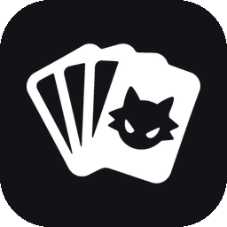
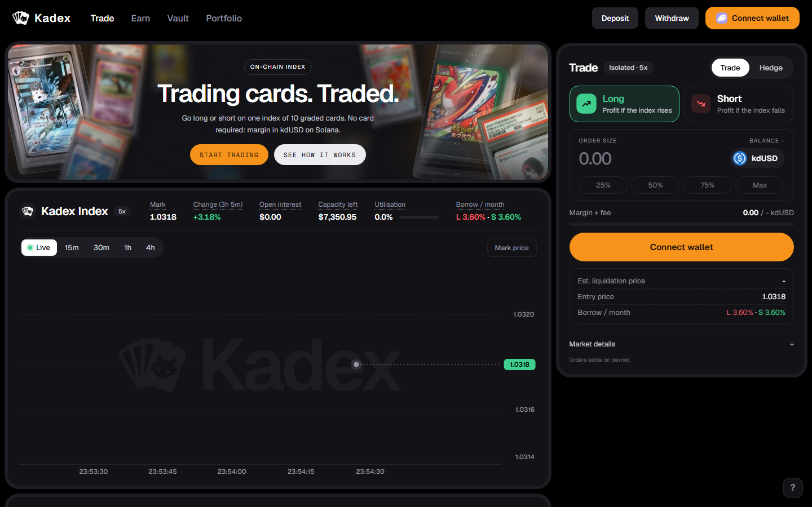
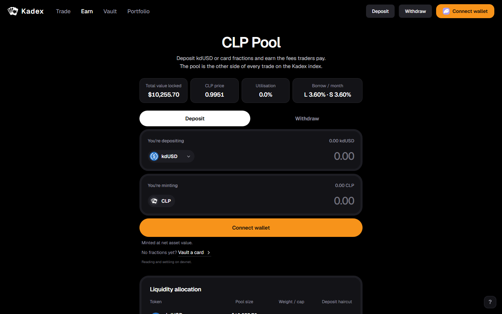
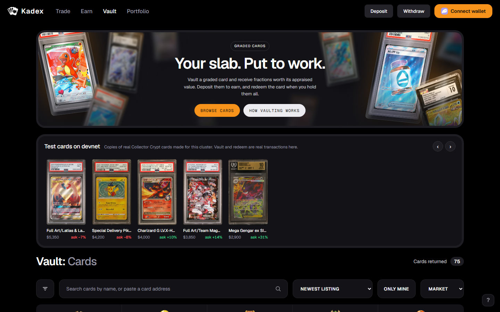
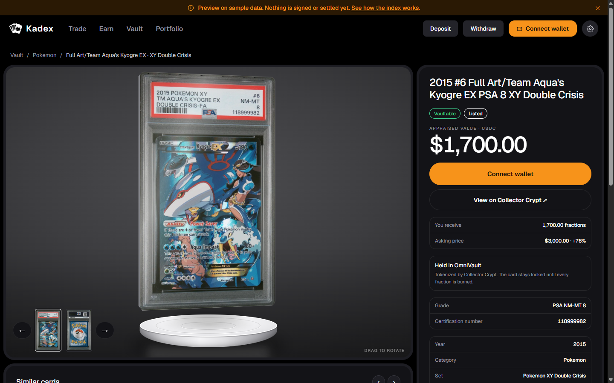
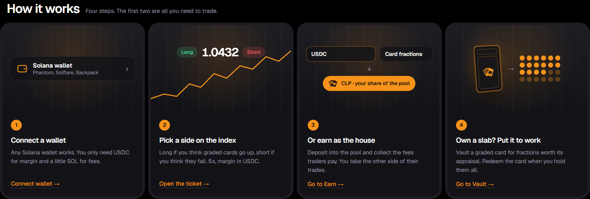

<a id="readme-top"></a>

<!-- PROJECT LOGO -->
<br />
<div align="center">
  <a href="https://github.com/kadex-protocol/Kadex">
    
  </a>

  <h1 align="center">Kadex</h1>

  <p align="center">
    Perpetual futures on an index of tokenized graded trading cards, on <strong>Solana</strong>. Go long or short on the card market with USDC margin — the price comes from an on-chain AMM of card fractions, <strong>not from a signed oracle</strong>.
    <br />
    <a href="docs/architecture.md"><strong>📄 Architecture</strong></a>
    ·
    <a href="docs/invariants.md"><strong>🧮 Economic Invariants</strong></a>
    ·
    <a href="docs/oracle.md"><strong>🔮 Oracle Design</strong></a>
  </p>

  <p align="center">
    
    
    
    
    
  </p>
</div>

> [!IMPORTANT]
> Hackathon entry for **Colosseum 2026**. Preview build: without a cluster configured the web app runs on sample data and nothing is signed or settled. No mainnet deployment, no real money. Not affiliated with Collector Crypt, PSA, CGC, or any card publisher; card images belong to their owners.

<div align="center">
  
</div>

<p align="center">
  <strong>5</strong> programs · <strong>12</strong> economic invariants · <strong>173</strong> rule tests in under a second · <strong>0</strong> oracle keys
</p>

> [!TIP]
> **Try it locally in two commands — no wallet, no validator.** `npm install && npm run web`, then open **[localhost:3000](http://localhost:3000)**. The app boots in preview mode on sample data; point it at a cluster with `npm run dev:chain` to sign real transactions. See [Getting Started](#getting-started).

## Evaluation Snapshot

Kadex is designed to read as more than a demo: it is a derivatives market for an asset class that has never had one. The judging shortcut is simple:

- **Unique concept:** graded cards are a multi-billion market you can only be long, by owning the card. Kadex lets anyone go long *or short* on an index of them, without buying, shipping, or storing a slab.
- **No oracle key to steal:** the price is recomputed from on-chain AMM reserves by a permissionless `refresh_price`. If our keeper dies, anyone can keep the market alive.
- **Real assets, not mock data:** the vault reads Collector Crypt's live marketplace — 160k+ tokenized graded cards already on Solana — and fractionalizes them into the pool.
- **Risk you can audit:** every rule lives in one crate that physically cannot read an account. Twelve economic invariants, each one a named test.
- **Business path:** trading fees and utilization-priced borrow flow to liquidity providers; card owners get yield on a slab that used to sit in a safe.

<!-- TABLE OF CONTENTS -->
<details>
  <summary>Table of Contents</summary>
  <ol>
    <li><a href="#evaluation-snapshot">Evaluation Snapshot</a></li>
    <li>
      <a href="#about-the-project">About the Project</a>
      <ul>
        <li><a href="#the-three-sides">The Three Sides</a></li>
        <li><a href="#how-cards-feed-the-market">How Cards Feed the Market</a></li>
      </ul>
    </li>
    <li><a href="#features">Features</a></li>
    <li><a href="#built-with">Built With</a></li>
    <li><a href="#architecture">Price &amp; Architecture — no oracle key</a></li>
    <li><a href="#who-it-serves">Who It Serves</a></li>
    <li>
      <a href="#getting-started">Getting Started</a>
      <ul>
        <li><a href="#prerequisites">Prerequisites</a></li>
        <li><a href="#installation">Installation</a></li>
      </ul>
    </li>
    <li><a href="#apps">Apps &amp; Packages</a></li>
    <li><a href="#roadmap">Roadmap</a></li>
    <li><a href="#compliance">Compliance</a></li>
    <li><a href="#license">License</a></li>
    <li><a href="#team">Team &amp; Contributors</a></li>
    <li><a href="#contact">Contact</a></li>
  </ol>
</details>

## About the Project

<div id="about-the-project"></div>

**Kadex** turns the graded-card market into something you can trade. Today the only position a collector can take is "own the card": thousands of dollars up front, weeks to exit, and no way to bet against a price or hedge the stock on the shelf. Kadex puts one index on-chain and builds a perpetual market on top of it.

### The Three Sides

<div id="the-three-sides"></div>

- **📈 Trade** — go long or short on the Kadex Index at 5x with isolated USDC margin. The ticket shows margin, entry, and the real liquidation price before you sign.
- **🏦 Earn** — deposit USDC or card fractions into the CLP pool and receive CLP. The pool is the counterparty to every trade and collects the trading and borrow fees.
- **🗄️ Vault** — lock a graded card and receive fractions worth its appraised value. Deposit them to earn; redeem the card when you hold them all.

> The defining mechanic: **the market prices itself**. The card fractions in the vault trade in an AMM, that AMM is the price source, and the size of the perp market is capped by how deep that AMM is. See [Architecture](#architecture).

### How cards feed the market

<div id="how-cards-feed-the-market"></div>

The cards are the engine behind every screen, not decoration on the home page.

| Side | What the cards provide | What Kadex turns it into |
|---|---|---|
| **Trade** | AMM reserves of card fractions, read on-chain | The index price, the TWAP, the liquidation price, and the open-interest ceiling |
| **Earn** | Fractions deposited next to USDC, at a 3% haircut | A two-sleeve pool: the USDC sleeve pays winning traders, the card sleeve never does |
| **Vault** | Collector Crypt NFTs with a graded appraisal | SPL fractions minted 1:1 with appraised value, redeemable for the original card |

The value is the same asset creating three products: Vault brings the cards on-chain, Earn turns them into liquidity, Trade lets everyone else take a view on them.

<p align="right">(<a href="#readme-top">Back to top</a>)</p>

## Features

<div id="features"></div>

<!-- FEATURE: Trade -->
<table width="100%">
<tr>
<td>

<h3>📈 Trade — long or short the card index</h3>

<p>One index, one ticket. Pick a side, type a size, and see margin, fees, and the <strong>liquidation price computed by the same function the program uses</strong>. Borrow is priced by utilization, and the crowded side pays more — both rates stay visible in the ticket. <strong>Hedge mode</strong> reframes the short for dealers, sized in inventory value.</p>

<div align="center">
  
</div>

</td>
</tr>
</table>

<!-- FEATURE: Earn -->
<table width="100%">
<tr>
<td>

<h3>🏦 Earn — be the house</h3>

<p>Deposit USDC or card fractions and receive <strong>CLP</strong>, minted at net asset value. The pool takes the other side of every trade. Withdrawals return a proportional slice of <strong>both</strong> sleeves, so no one exits with only the liquid part.</p>

<div align="center">
  
</div>

</td>
</tr>
</table>

<!-- FEATURE: Vault + card page -->
<table width="100%">
<tr>
<td colspan="2">

<h3>🗄️ Vault — real graded cards · 🃏 a page per card</h3>

<p>The vault is a marketplace of <strong>real tokenized cards</strong>, read live from Collector Crypt and verified against the chain: search by name or address, filter by category, and open any card to see its grade, certification number, appraisal, and how many fractions it would mint. The slab around each card — acrylic case, label, barcode — is drawn in CSS and rotates in 3D.</p>

</td>
</tr>
<tr>
<td width="50%" valign="top"></td>
<td width="50%" valign="top"></td>
</tr>
<tr>
<td colspan="2">

<ul>
  <li>Only whitelisted Metaplex Core cards can be vaulted, with a maximum weight per card in the index.</li>
  <li>Fractions have 6 decimals, like USDC — a price times a quantity lands directly in native USDC.</li>
  <li>The NFT sits in a PDA escrow until every fraction is burned; then the original card comes back.</li>
</ul>

</td>
</tr>
</table>

<!-- FEATURE: Onboarding -->
<table width="100%">
<tr>
<td>

<h3>🧭 Onboarding — four steps, two to trade</h3>

<p>Any Solana wallet is detected and offered — Phantom, Solflare, Backpack. A first-visit walkthrough and a permanent <strong>How it works</strong> strip explain each side in one sentence, and a <strong>Portfolio</strong> page shows positions, CLP, and fractions in one place.</p>

<div align="center">
  
</div>

</td>
</tr>
</table>

<p align="right">(<a href="#readme-top">Back to top</a>)</p>

## Built With

<div id="built-with"></div>

[![Rust][rust-badge]][rust-url]
[![Solana][sol-badge]][sol-url]
[![Anchor][anchor-badge]][anchor-url]
[![TypeScript][ts-badge]][ts-url]
[![Next.js][next-badge]][next-url]
[![React][react-badge]][react-url]

- **Chain:** Solana · five Anchor programs — `oracle`, `card-vault`, `clp-pool`, `perp`, `mock-amm`
- **Risk:** `kadex-math` (fixed point, no floats) · `kadex-risk` (every rule, no Anchor, no Solana) · `kadex-interface` (frozen account contracts)
- **Front:** Next.js 15 (App Router) · React 19 · hand-written CSS design system with switchable themes · native wallet detection
- **SDK:** `@kadex/types` · `@kadex/sdk` (PDAs, account decoding, instruction builders, Rust-parity maths) · `@kadex/oracle` · `@kadex/collector-crypt`
- **Bots:** permissionless price keeper · liquidator · external price feed
- **Data:** Collector Crypt public marketplace API, cross-checked on mainnet-beta — see [`docs/collector-crypt.md`](docs/collector-crypt.md)

<p align="right">(<a href="#readme-top">Back to top</a>)</p>

## Price & Architecture — no oracle key

<div id="architecture"></div>

Every number on screen originates from on-chain state. There is no signed price feed and no admin who can set the mark: one AMM, one permissionless refresh, many consumers.

### Where the price comes from

| Source | What it carries | How we use it |
|---|---|---|
| **AMM reserves** | USDC and fraction balances of the card pool | Spot price, at most once per slot |
| **Running integral** | Σ spot × seconds in force | 30-minute time-weighted TWAP |
| **Clamp** | 5% per 15 seconds of elapsed time | The official price used for PnL, liquidation, and NAV |
| **External median** | Off-chain card fills | A sanity bound only — never a price source |

### One price, many consumers

```
external AMM reserves
        ▼
[oracle] spot → time-weighted TWAP → clamp → OFFICIAL PRICE
        ▼
   OracleAccount ─► an account read, no CPI
        ▼
[perp] open · close · liquidate ──CPI──► [clp-pool] NAV · sleeves · CLP
        ▲                                      ▲
[card-vault] NFT ↔ fractions ──────────────────┘
```

The core idea: **the only thing crossing the boundary is the oracle account**. `perp` deserializes it and Anchor checks the owner on its own, so a forged account is rejected before any of our logic runs. Because `refresh_price` is permissionless, every defence is expressed in time, never in calls — one update per slot, time-weighted TWAP, a time-scaled clamp, a minimum depth over the window, and an external divergence bound.

### What keeps the pool solvent

- **Two ceilings, the lower one wins:** open interest is capped by both pool solvency and AMM depth. An opening that would breach either is refused in the same transaction.
- **Utilization-priced borrow:** the rate climbs quadratically, so the pool becomes expensive before it is cornered.
- **The card sleeve never pays a winning trader:** payouts come from USDC only; bad debt is explicit, not hidden in NAV.
- **Thin handlers, enforced by tests:** a handler over 45 lines fails the build, and so does `kadex-risk` gaining a Solana dependency.

> 📄 **Go deeper.** [`docs/spec.md`](docs/spec.md) is the whole design end to end and where it stops today; [`docs/architecture.md`](docs/architecture.md) covers program boundaries, token custody, and arithmetic scales; [`docs/invariants.md`](docs/invariants.md) lists the twelve rules with the test that guards each; [`docs/oracle.md`](docs/oracle.md) documents every defence and the attack it blocks; [`docs/deploying.md`](docs/deploying.md) explains the build and the fixed program IDs.

<p align="right">(<a href="#readme-top">Back to top</a>)</p>

## Who It Serves

<div id="who-it-serves"></div>

Five roles, each with a screen built for it — detailed in [`docs/users.md`](docs/users.md):

| Role | Wants | How Kadex answers it |
|---|---|---|
| **Speculator** | Directional exposure without owning a card | Trade ticket with margin, entry, and liquidation price up front; Portfolio for open positions |
| **Liquidity provider** | Yield for being the counterparty | Earn page with pool value, CLP price, haircut, and share of pool before depositing |
| **Card owner** | Liquidity without selling | Vault a slab for fractions, deposit them to earn, redeem the card later |
| **Dealer hedging stock** | Insurance on inventory | Hedge mode — a short sized in the value of the stock it protects |
| **Arbitrageur** | The long/short borrow spread | Both borrow rates permanently visible in the ticket and the market bar |

And the hard requirements: **built on Solana** ✅ · **functional programs, not a mockup** ✅ (74 tests against a local validator) · **public repository** ✅.

> 🔗 **Proof it's on-chain:** the five program IDs are fixed in [`Anchor.toml`](Anchor.toml) and [`keys/`](keys), and `npm run test:integration` boots a validator, deploys all five, and runs the full lifecycle — vault, deposit, open, liquidate, settle, redeem.

<p align="right">(<a href="#readme-top">Back to top</a>)</p>

## Getting Started

<div id="getting-started"></div>

One npm workspace for the TypeScript side and one Cargo workspace for the Rust side, in the same repository.

### Prerequisites

<div id="prerequisites"></div>

- Node.js 22+
- Rust 1.89 (`rust-toolchain.toml` pins it), Solana CLI 3.1.10, and Anchor CLI 1.2.0 when building or testing the programs
- (optional) A Solana wallet such as Phantom, Solflare, or Backpack — preview mode works without one

### Installation

<div id="installation"></div>

```bash
git clone https://github.com/kadex-protocol/Kadex.git
cd Kadex
npm install

# 1) Web app in preview mode (sample data, nothing signed)
npm run web                            # http://localhost:3000

# 2) Programs
npm run sync-keys                      # keys/ -> target/deploy/ (fixed program IDs)
npm run build:programs                 # NOT a bare `anchor build` — see docs/deploying.md
cargo test --workspace                 # 173 rule tests, under a second
npm run test:parity                    # 21 Rust <-> TS parity tests
npm run test:history                   # 12 price-history parser tests
npm run test:raydium                   # 23 Raydium reader tests on a captured devnet pool
npm run test:integration               # 74 tests against a local validator

# 3) Web app against a real local cluster (separate terminal)
npm run dev:chain                      # validator + all five programs + a seeded market
```

> `dev:chain` prints the values for `NEXT_PUBLIC_KADEX_RPC_URL` and `NEXT_PUBLIC_KADEX_USDC_MINT`; with both set the app leaves preview mode and sends real transactions. Do not run `anchor build` on its own — it emits SBPF v3 binaries the Solana CLI cannot deploy. See [`docs/deploying.md`](docs/deploying.md) and [`docs/frontend-contract.md`](docs/frontend-contract.md).

<p align="right">(<a href="#readme-top">Back to top</a>)</p>

## Apps & Packages

<div id="apps"></div>

| Path | Stack | What |
|---|---|---|
| [`apps/web`](apps/web) | Next.js 15 + React 19 | Trade, Earn, Vault, Portfolio, index methodology (port 3000) |
| [`apps/keeper`](apps/keeper) | TypeScript | Permissionless `refresh_price` loop |
| [`apps/liquidator`](apps/liquidator) | TypeScript | Scans positions and liquidates below maintenance |
| [`apps/external-feed`](apps/external-feed) | TypeScript | Publishes the external median used as a sanity bound |
| [`programs/oracle`](programs/oracle) | Anchor | Price: TWAP, clamp, depth, divergence |
| [`programs/card-vault`](programs/card-vault) | Anchor | NFT ↔ SPL fractions, whitelist, max weight |
| [`programs/clp-pool`](programs/clp-pool) | Anchor | Pool, NAV, sleeves, CLP mint and burn |
| [`programs/perp`](programs/perp) | Anchor | Positions, borrow index, liquidation |
| [`programs/mock-amm`](programs/mock-amm) | Anchor | Constant-product price surface for local and devnet |

```text
Kadex/
├─ apps/        # web, keeper, liquidator, external-feed
├─ programs/    # oracle, card-vault, clp-pool, perp, mock-amm
├─ packages/    # kadex-math, kadex-risk, kadex-interface (Rust) · types, sdk, oracle, collector-crypt (TS)
├─ tests/       # parity, price history, integration (local validator), Collector Crypt
├─ scripts/     # build, validator harness, dev chain, whitelist
└─ docs/        # spec, architecture, invariants, oracle, custody, deploying, users
```

<p align="right">(<a href="#readme-top">Back to top</a>)</p>

## Roadmap

<div id="roadmap"></div>

- [x] Workspace scaffold — Cargo + npm, fixed program IDs, deployable build pipeline
- [x] **Risk core** — fixed-point maths and every rule in a crate with no Solana dependency
- [x] **Oracle** — permissionless refresh, time-weighted TWAP, clamp, depth and divergence defences
- [x] **Card vault** — full NFT ↔ fraction cycle with whitelist and per-card weight
- [x] **CLP pool** — deposit, withdraw, NAV, two sleeves, explicit bad debt
- [x] **Perp** — open, close, liquidate, borrow index, reduce-only and settled states
- [x] **SDK** — PDAs, account decoding, instruction builders, Rust ↔ TS parity tests
- [x] **Collector Crypt integration** — live marketplace, per-card pages, Core whitelist
- [x] **Web app** — Trade, Earn, Vault, Portfolio, wallet detection, real deposits and positions on a local cluster
- [x] **Price history** — the index chart read back from on-chain `PriceRefreshed` events, no indexer
- [ ] **Index token** — one basket mint backed by the weighted vaulted cards ([#1](https://github.com/kadex-protocol/kadex/issues/1))
- [ ] **Public devnet deploy** — hosted app and demo video with the submission
- [ ] **Real AMM adapter** — replace `mock-amm` with a live venue for the fraction pool
- [ ] **Mainnet readiness** — fresh program keypairs, audit, upgrade-authority handoff
- [ ] **More indices** — per-category baskets (Pokémon, One Piece, sports) on the same engine

<p align="right">(<a href="#readme-top">Back to top</a>)</p>

## Compliance

<div id="compliance"></div>

- **No third-party IP claimed** — no affiliation with Collector Crypt, grading companies, or card publishers; card images are shown as marketplace listings and belong to their owners.
- **No mainnet deployment** — local and devnet only; no real-money movement during the hackathon.
- **Honest preview mode** — sample data is labelled as such on every screen until a cluster is configured.
- **Risk disclosure built in** — liquidation price, borrow cost, and the counterparty nature of the pool are shown before signing.
- **Natural-person authorship** — AI used as a tool; a human team owns the submission.

<p align="right">(<a href="#readme-top">Back to top</a>)</p>

## License

<div id="license"></div>

No license file has been added to the repository yet. Until one is, all rights are reserved by the authors.

<p align="right">(<a href="#readme-top">Back to top</a>)</p>

## Team & Contributors

<div id="team"></div>

<table>
  <tr>
    <td align="center">
      <a href="https://github.com/Kc1t">
        <br />
        <sub><b>Kauã Miguel</b></sub>
      </a><br />
      <sub>Owner · <a href="https://github.com/Kc1t">@Kc1t</a></sub>
    </td>
    <td align="center">
      <a href="https://github.com/eudehh">
        <br />
        <sub><b>Deborah Pavanelli Colicchio</b></sub>
      </a><br />
      <sub>Member · <a href="https://github.com/eudehh">@eudehh</a></sub>
    </td>
    <td align="center">
      <a href="https://github.com/opedrooz">
        <br />
        <sub><b>Pedro Henrique</b></sub>
      </a><br />
      <sub>Member · <a href="https://github.com/opedrooz">@opedrooz</a></sub>
    </td>
  </tr>
</table>

<p align="right">(<a href="#readme-top">Back to top</a>)</p>

## Contact

<div id="contact"></div>

Team Kadex · Repository: [https://github.com/kadex-protocol/Kadex](https://github.com/kadex-protocol/Kadex)

<p align="right">(<a href="#readme-top">Back to top</a>)</p>

<!-- BADGE LINKS -->
[rust-badge]: https://img.shields.io/badge/Rust-000000?style=for-the-badge&logo=rust&logoColor=white
[rust-url]: https://www.rust-lang.org/
[sol-badge]: https://img.shields.io/badge/Solana-14F195?style=for-the-badge&logo=solana&logoColor=black
[sol-url]: https://solana.com/
[anchor-badge]: https://img.shields.io/badge/Anchor-2B2D42?style=for-the-badge&logo=anchor&logoColor=white
[anchor-url]: https://www.anchor-lang.com/
[ts-badge]: https://img.shields.io/badge/TypeScript-3178C6?style=for-the-badge&logo=typescript&logoColor=white
[ts-url]: https://www.typescriptlang.org/
[next-badge]: https://img.shields.io/badge/Next.js-000000?style=for-the-badge&logo=nextdotjs&logoColor=white
[next-url]: https://nextjs.org/
[react-badge]: https://img.shields.io/badge/React-20232A?style=for-the-badge&logo=react&logoColor=61DAFB
[react-url]: https://react.dev/
