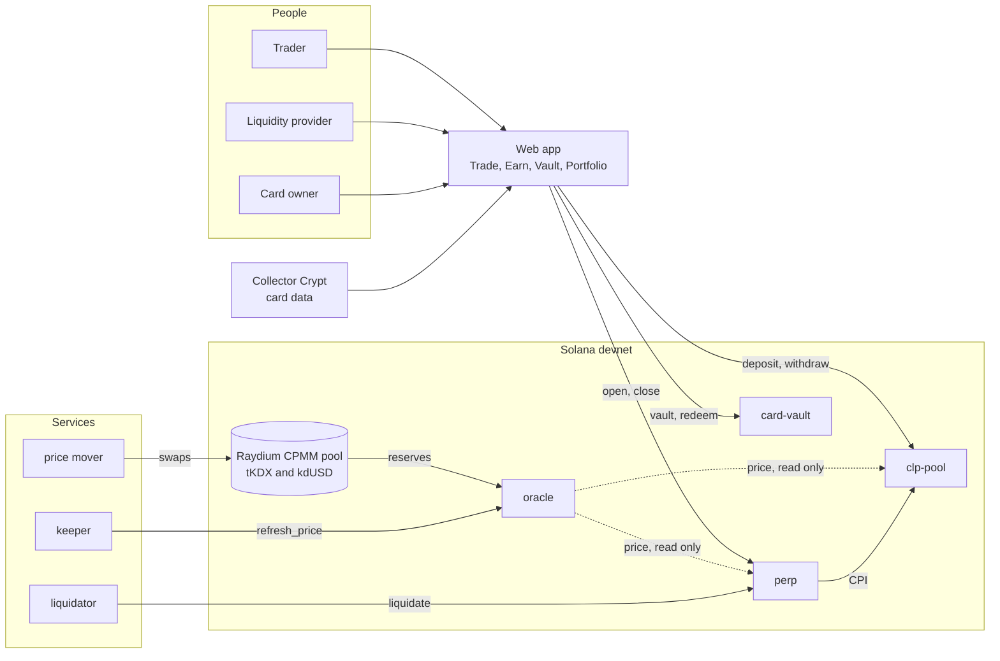

<div align="center">
  <a href="https://kadex.kc1t.com"></a>
  <h1>Kadex</h1>
  <p><strong>Perpetual futures on an index of tokenized graded trading cards, on Solana.</strong></p>
  <p>
    <a href="https://web-devnet-production.up.railway.app"><strong>Live app</strong></a>
    &nbsp;·&nbsp;
    <a href="https://kadex-deck-production.up.railway.app"><strong>Pitch deck</strong></a>
    &nbsp;·&nbsp;
    <a href="docs/README.md"><strong>Docs</strong></a>
  </p>
  <p>
    
    
    
    
    
  </p>
</div>

<p align="center">
  
</p>

## What it is

Kadex turns the graded card market into something you can trade. A collector can own a card or sell it. Kadex adds the positions that were missing: a short, a leveraged long, and a hedge for someone who holds inventory. It puts one index on chain, the Kadex Index, and builds a perpetual market on it.

| Side | What you do | Program |
|---|---|---|
| **Trade** | Go long or short on the index with up to 5x leverage. Margin is posted in `kdUSD`. The ticket shows margin, fee and liquidation price before you sign. | `perp` |
| **Earn** | Deposit `kdUSD` or the index token `tKDX` and receive CLP shares. The pool takes the other side of every trade and collects trading fees and borrow. | `clp-pool` |
| **Vault** | Lock a whitelisted graded card and receive fractions equal to its appraised value. Return every fraction to take the card back. | `card-vault` |

What makes it different:

- **No oracle key.** The index price is recomputed from the reserves of an on-chain AMM pool by a permissionless instruction, `refresh_price`. If the keeper stops, anyone can keep the price alive.
- **Two ceilings on open interest.** A position is admitted only if the pool can pay it and the pricing pool is deep enough that pushing the price costs more than it pays. The lower ceiling wins, in the same transaction.
- **Rules you can test.** Every risk rule is a pure function in a crate with no Solana dependency. 185 Rust tests run without a validator, and 78 more run the deployed binaries on a local one.
- **Real card data.** The Vault page lists Collector Crypt's marketplace of tokenized graded cards, and the vault program only accepts a card from its registered collection.

## Screens

Captured from the devnet app.

| Trade | Earn |
|---|---|
|  |  |

| Vault | Card page |
|---|---|
|  |  |

<p align="center">
  
</p>

## How the pieces connect



The oracle program turns the pool's reserves into one official price: a 30-minute time-weighted average, capped at 5% of movement per 15 seconds. `perp` settles every position at that price and calls `clp-pool`, the only program that pays a trader. More graphs: [docs/system-map.md](docs/system-map.md) and [docs/flows.md](docs/flows.md).

## Live on Solana devnet

Deployed on 12 Oct 2026. The tokens are devnet test tokens.

| What | Address |
|---|---|
| `oracle` program | [`5288ShBXsFxqXiGm22FZi1ZrMnmet4i1ZR3bccyAguqp`](https://explorer.solana.com/address/5288ShBXsFxqXiGm22FZi1ZrMnmet4i1ZR3bccyAguqp?cluster=devnet) |
| `clp_pool` program | [`3XZkAqLeQDoNXD6Bb9YoGSEdnvqk9r7UMgrKsN5x3L9v`](https://explorer.solana.com/address/3XZkAqLeQDoNXD6Bb9YoGSEdnvqk9r7UMgrKsN5x3L9v?cluster=devnet) |
| `perp` program | [`BcVwJ91Jd1k7xUNcGYzRygq2ubaCYn7p5MeUZzy1EyLR`](https://explorer.solana.com/address/BcVwJ91Jd1k7xUNcGYzRygq2ubaCYn7p5MeUZzy1EyLR?cluster=devnet) |
| `card_vault` program | [`J8Tef8N4YSfVwAxpBemCZrz3qCxehTeb2cd1jTwoBczW`](https://explorer.solana.com/address/J8Tef8N4YSfVwAxpBemCZrz3qCxehTeb2cd1jTwoBczW?cluster=devnet) |
| `kdUSD`, the stable token | [`E2zRTPSvxyqTuiPvnGinCRWDLAfXUkNdLfUVcaFpTCzc`](https://explorer.solana.com/address/E2zRTPSvxyqTuiPvnGinCRWDLAfXUkNdLfUVcaFpTCzc?cluster=devnet) |
| `tKDX`, the index token | [`FKNJbb86SZMFZgDVTK48atX4xiqwqACVDQi4vSaSx7F2`](https://explorer.solana.com/address/FKNJbb86SZMFZgDVTK48atX4xiqwqACVDQi4vSaSx7F2?cluster=devnet) |
| Raydium CPMM pool, the price source | [`FCidcNbQYoe24VwdkMwHeBWjdt3Jqz5Qazh7xPuMWdhV`](https://explorer.solana.com/address/FCidcNbQYoe24VwdkMwHeBWjdt3Jqz5Qazh7xPuMWdhV?cluster=devnet) |
| Oracle account | [`HGjtgccRYwgvcNwrxjhSgb43UV1yr75PYpCGTKe5gz3h`](https://explorer.solana.com/address/HGjtgccRYwgvcNwrxjhSgb43UV1yr75PYpCGTKe5gz3h?cluster=devnet) |
| CLP pool | [`Fp2cJu1yguxGUWM1c4f8HHZJivPtH7vEHYZ9wW4hHECN`](https://explorer.solana.com/address/Fp2cJu1yguxGUWM1c4f8HHZJivPtH7vEHYZ9wW4hHECN?cluster=devnet) |
| Perp market | [`4Z3vkbxEYsGKBJBZJZ4xaEkjnzCEBYmwgo5aLmujB6o1`](https://explorer.solana.com/address/4Z3vkbxEYsGKBJBZJZ4xaEkjnzCEBYmwgo5aLmujB6o1?cluster=devnet) |

Try it: open the [live app](https://web-devnet-production.up.railway.app), connect a wallet or pick the built-in demo wallet, and the faucet sends test SOL and `kdUSD`. Every account, parameter and test card is listed in [docs/devnet.md](docs/devnet.md). The raw record is [`deployments/devnet.json`](deployments/devnet.json).

## Quick start

Requirements: Node.js 22 or newer. To build and test the programs: Rust 1.89, Solana CLI 3.1.10 and Anchor CLI 1.2, in a POSIX shell (WSL on Windows).

```bash
git clone https://github.com/kadex-protocol/Kadex.git
cd Kadex
npm install
npm run typecheck          # compiles the TypeScript packages the app and the scripts import
```

**Web app against devnet.** In `apps/web/.env.local` set `NEXT_PUBLIC_KADEX_RPC_URL` to a devnet RPC endpoint and `NEXT_PUBLIC_KADEX_USDC_MINT` to the `kdUSD` mint from the table above. Then:

```bash
npm run web                # http://localhost:3000
```

**Programs and tests.**

```bash
npm run sync-keys          # copies the program keypairs to target/deploy
npm run build:programs     # deployable build, see docs/deploying.md
npm run test:rust          # 185 Rust tests, no validator
npm run test:parity        # TypeScript maths equals the Rust
npm run test:integration   # 78 tests on a local validator
```

**Services against devnet.**

```bash
npm run keeper             # refresh_price on a loop
npm run liquidator         # liquidates positions below maintenance margin
```

Both services read the addresses from `deployments/devnet.json` and pay fees from the keypair named by `KADEX_SERVICE_KEYPAIR`. `npm run dev:chain -- <wallet>` boots a local validator with the programs deployed and a seeded pool. All suites: [docs/testing.md](docs/testing.md).

## Repository map

| Path | What it holds |
|---|---|
| [`apps/web`](apps/web) | Next.js app: Trade, Earn, Vault, Portfolio and the API routes |
| [`apps/keeper`](apps/keeper), [`apps/liquidator`](apps/liquidator), [`apps/external-feed`](apps/external-feed) | The off-chain services |
| [`programs`](programs) | The Anchor programs: `oracle`, `clp-pool`, `perp`, `card-vault` |
| [`packages`](packages) | Rust crates `kadex-math`, `kadex-risk`, `kadex-interface`, and TypeScript packages `types`, `sdk`, `oracle`, `collector-crypt` |
| [`deployments`](deployments) | Devnet addresses, the launch basket and the IDLs |
| [`scripts`](scripts) | Build, devnet deployment, price mover, basket selection |
| [`tests`](tests) | Parity, history, Raydium reader, Collector Crypt and validator suites |
| [`docs`](docs/README.md) | The documentation graph |

## Documentation

The documents form a graph with one entry point, [docs/README.md](docs/README.md). AI readers can start at [llms.txt](llms.txt).

| To | Read |
|---|---|
| Understand the product | [overview](docs/overview.md), [users](docs/users.md), [glossary](docs/glossary.md) |
| See how everything connects | [system map](docs/system-map.md), [architecture](docs/architecture.md) |
| Follow a flow step by step | [flows](docs/flows.md) |
| Look up an instruction, account or error | [programs](docs/programs.md) |
| Understand the price and the rules | [oracle](docs/oracle.md), [invariants](docs/invariants.md) |
| Work on the web app | [web app](docs/web-app.md), [frontend contract](docs/frontend-contract.md) |
| Run the services and scripts | [services](docs/services.md) |
| Find a devnet address | [devnet](docs/devnet.md) |
| Build, deploy and test | [deploying](docs/deploying.md), [testing](docs/testing.md) |
| Check custody and keys | [custody](docs/custody.md), [upgrade authority](docs/upgrade-authority.md) |

## Roadmap

- [x] Risk core, oracle, pool, perp and card vault programs
- [x] Raydium CPMM pool as the price source
- [x] Web app with Trade, Earn, Vault, Portfolio and hedge mode
- [x] Devnet deployment with hosted app, keeper and liquidator
- [ ] Index token backed by vaulted cards, so a card's fractions can enter the Earn pool ([#1](https://github.com/kadex-protocol/Kadex/issues/1))
- [ ] Vault the ten-card launch basket in [`deployments/basket.json`](deployments/basket.json)
- [ ] Multisig with a timelock as upgrade authority, and split admin roles
- [ ] Mainnet readiness: fresh program keypairs, audit, legal review

## Team

| Name | Role | GitHub |
|---|---|---|
| Kauã Miguel | Fullstack dev | [@Kc1t](https://github.com/Kc1t) |
| Deborah Pavanelli Colicchio | Web3 developer | [@eudehh](https://github.com/eudehh) |
| Pedro Henrique | Backend dev | [@opedrooz](https://github.com/opedrooz) |

Built for Colosseum 2026. Kadex runs on Solana devnet with test tokens. It is not affiliated with Collector Crypt or any grading company, and card images belong to their owners.
