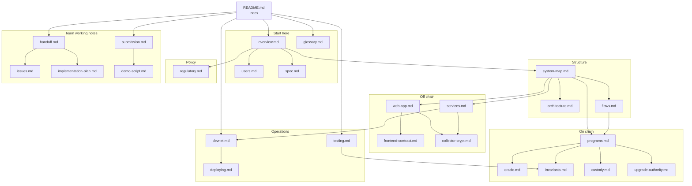

# Kadex documentation

> Entry point for people and for AI readers. Repository overview: [../README.md](../README.md). Machine index: [../llms.txt](../llms.txt).

Kadex is a perpetual futures market on an index of tokenized graded trading cards, built on Solana and live on devnet. These documents form a graph. This page is the root: pick a question in the routing table, or walk the graph below.

## How to walk these documents

- Every document starts with one routing line: where it sits, its parent (`Up`) and its neighbours (`Related`).
- Every document ends with a `Where to go next` list.
- Structure and flows are drawn as Mermaid graphs. Prose explains what a graph cannot.
- Order of trust when two sources disagree: the source code, then [`deployments/devnet.json`](../deployments/devnet.json), then these documents. The team working notes are dated and describe the state on their review date.

## Document graph

Nodes are files in this folder. An arrow means "read next".

## Start here by question

| Question | Read |
|---|---|
| What is Kadex, and who uses it? | [overview.md](overview.md), then [users.md](users.md) |
| What does a term mean (CLP, sleeve, WAD, kdUSD)? | [glossary.md](glossary.md) |
| How do the programs, crates, packages and apps depend on each other? | [system-map.md](system-map.md#code-dependencies) |
| Which accounts exist and how are their addresses derived? | [system-map.md](system-map.md#accounts-and-pdas) |
| Where does each token move? | [system-map.md](system-map.md#token-flow) |
| How is the price computed? | [oracle.md](oracle.md), [programs.md](programs.md#oracle), [flows.md](flows.md#price-refresh) |
| What happens when a position is opened or closed? | [flows.md](flows.md#open-a-position), [flows.md](flows.md#close-a-position) |
| When is a position liquidated, and by whom? | [flows.md](flows.md#liquidation), [services.md](services.md#liquidator) |
| How much open interest can the market take? | [invariants.md](invariants.md), [programs.md](programs.md#perp) |
| What does the Earn pool accept, and how is CLP priced? | [programs.md](programs.md#clp-pool), [flows.md](flows.md#earn-deposit) |
| How does a card become fractions, and come back? | [flows.md](flows.md#vault-a-card), [custody.md](custody.md) |
| Which instructions, accounts, events and errors does a program have? | [programs.md](programs.md) |
| Where does the card data come from? | [collector-crypt.md](collector-crypt.md) |
| What is live on devnet, and at which addresses? | [devnet.md](devnet.md#addresses) |
| How do I try it? | [devnet.md](devnet.md#try-it) |
| Which pages and API routes does the web app have? | [web-app.md](web-app.md) |
| How does the frontend read accounts and build transactions? | [frontend-contract.md](frontend-contract.md) |
| Which processes run off chain, and how are they started? | [services.md](services.md) |
| Which environment variables exist? | [web-app.md](web-app.md#environment-variables), [services.md](services.md#environment-variables) |
| How do I build and deploy the programs? | [deploying.md](deploying.md) |
| How is it tested? | [testing.md](testing.md) |
| Which economic rules must always hold? | [invariants.md](invariants.md) |
| Who can upgrade or administer the programs? | [upgrade-authority.md](upgrade-authority.md) |
| What is the regulatory position? | [regulatory.md](regulatory.md) |
| What is planned next? | [overview.md](overview.md#roadmap) |

## All documents

### Start here

| Document | Summary |
|---|---|
| [overview.md](overview.md) | What Kadex is, the three sides (Trade, Earn, Vault), the actors, the main parameters and the roadmap. |
| [glossary.md](glossary.md) | Every term, token and unit used in the code and in these documents. |
| [users.md](users.md) | The five user roles and the screen that serves each one. |
| [spec.md](spec.md) | The design end to end in prose: card to fractions, fractions to price, pool, trading, off-chain actors. |

### Structure

| Document | Summary |
|---|---|
| [system-map.md](system-map.md) | Graphs of code dependencies, on-chain calls, accounts and PDAs, and token movements. |
| [architecture.md](architecture.md) | Program boundaries, code layers, token custody and arithmetic scales. |
| [flows.md](flows.md) | Each user and system flow as a sequence graph: trade, liquidation, price refresh, Earn, vault, hedge, faucet. |

### On chain

| Document | Summary |
|---|---|
| [programs.md](programs.md) | Per program: instructions, accounts, PDA seeds, events and errors. |
| [oracle.md](oracle.md) | How the price is built from AMM reserves, every defence and the attack it blocks, the Raydium CPMM adapter. |
| [invariants.md](invariants.md) | The economic invariants, each with the test that guards it, and the rounding policy. |
| [custody.md](custody.md) | Who holds each link between the physical card and its fractions, and what the programs check. |
| [upgrade-authority.md](upgrade-authority.md) | What the upgrade authority and the admin keys can do, and the plan before real funds. |

### Off chain

| Document | Summary |
|---|---|
| [web-app.md](web-app.md) | Pages, API routes, `lib/` modules and how they depend on each other, components, environment variables. |
| [frontend-contract.md](frontend-contract.md) | How the frontend uses `@kadex/sdk`: PDAs, decoders, derived values, transactions, price history. |
| [collector-crypt.md](collector-crypt.md) | The Collector Crypt marketplace and gacha APIs, the collection address, the launch basket and the external reference. |
| [services.md](services.md) | Keeper, liquidator, price mover, external feed and the scripts: what each does and how it is run. |

### Operations

| Document | Summary |
|---|---|
| [devnet.md](devnet.md) | What is live on Solana devnet: URLs, every address, parameters, test cards and how to try it. |
| [deploying.md](deploying.md) | Building deployable programs, who initializes, the devnet deployment script, hosting on Railway. |
| [testing.md](testing.md) | The test suites, what each proves, how to run them and how many tests each holds. |

### Policy

| Document | Summary |
|---|---|
| [regulatory.md](regulatory.md) | The regulatory questions the team declares and what legal review must cover before real funds. |

### Team working notes

Dated notes written during the build. They record decisions and reasoning. Where they describe the state of the code, check the date at the top of the note.

| Document | Summary |
|---|---|
| [handoff.md](handoff.md) | Onboarding note for developers: how to run it, what exists, the code pattern, what is frozen. |
| [issues.md](issues.md) | Design issues and the reasoning behind each decision, plus the audit of 6 Oct 2026. |
| [implementation-plan.md](implementation-plan.md) | How the code is split, where it deviates from the original spec, and the test strategy. |
| [demo-script.md](demo-script.md) | Shot list and narration for the recorded demo on the devnet site. |
| [submission.md](submission.md) | The hackathon submission text: problem, how Kadex works, what is built, known limits. |
| [naming.md](naming.md) | Product naming notes. Kept by its author and outside the routing graph. |

The folder also holds `media/` (images used by the repository README) and a draw.io file kept next to these documents.

## Source map

Where the facts in these documents come from.

| Topic | Source of truth |
|---|---|
| Program logic | [`programs/*/src`](../programs) |
| Shared account layouts, PDA seeds, states | [`packages/kadex-interface/src/lib.rs`](../packages/kadex-interface/src/lib.rs) |
| Risk rules | [`packages/kadex-risk/src/lib.rs`](../packages/kadex-risk/src/lib.rs) |
| Fixed-point arithmetic | [`packages/kadex-math/src/lib.rs`](../packages/kadex-math/src/lib.rs) |
| TypeScript SDK | [`packages/sdk/src`](../packages/sdk/src), [`packages/types/src/index.ts`](../packages/types/src/index.ts) |
| Devnet addresses and signatures | [`deployments/devnet.json`](../deployments/devnet.json) |
| Launch basket | [`deployments/basket.json`](../deployments/basket.json) |
| IDLs | [`deployments/idl`](../deployments/idl) |
| Commands | [`package.json`](../package.json) |

## Where to go next

- [overview.md](overview.md): the product in one page.
- [system-map.md](system-map.md): the structure as graphs.
- [devnet.md](devnet.md): what is live and how to try it.
