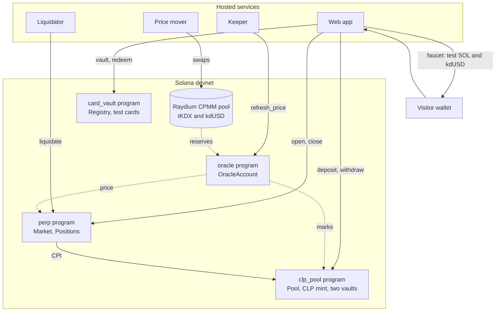
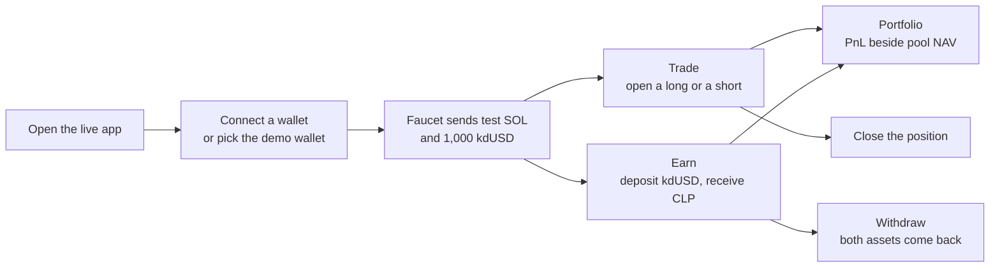

# Devnet

> [Docs](README.md) › Devnet · Up: [Docs index](README.md) · Related: [Deploying](deploying.md), [Services](services.md), [Programs](programs.md), [Web app](web-app.md)

Kadex has been live on Solana devnet since 12 Oct 2026. The source of every address on this page is [`deployments/devnet.json`](../deployments/devnet.json), written by [`scripts/devnet.mjs`](../scripts/devnet.mjs). Addresses link to the Solana explorer.

## What is live

| What | Where |
|---|---|
| Live app, wired to devnet | https://web-devnet-production.up.railway.app |
| Product domain, the same devnet build | https://kadex.kc1t.com |
| Pitch deck | https://kadex-deck-production.up.railway.app |
| Repository | https://github.com/kadex-protocol/Kadex |
| Machine-readable market state | `GET /api/market` on the live app |

## Try it

1. Open https://web-devnet-production.up.railway.app.
2. Connect a wallet set to devnet. Any wallet that implements the Wallet Standard is offered. The wallet picker also offers a built-in demo wallet that needs no extension.
3. On connect, the faucet sends a small amount of test SOL and 1,000 `kdUSD` to a wallet that has none.
4. **Trade.** On the home page pick Long or Short, type a size and read the margin, the fee and the liquidation price. Open the position. It appears in the account panel and in Portfolio, and can be closed from there.
5. **Earn.** On `/pool` deposit `kdUSD` and receive CLP. A withdrawal returns a proportional slice of both pool assets.
6. **Vault.** A wallet that owns a devnet test card can vault it and redeem it from the card page. The deployer issues test cards to a wallet with `node scripts/devnet.mjs cards <wallet>`.
7. **Index methodology.** `/index-methodology` shows the basket, both capacity ceilings and which one binds.

To point a local build at devnet, set `NEXT_PUBLIC_KADEX_RPC_URL` to a devnet RPC endpoint and `NEXT_PUBLIC_KADEX_USDC_MINT` to the `kdUSD` mint below, then run `npm run typecheck` and `npm run web`. A wallet funded once by the hosted faucet works in the local build too, because the funds are on chain.

## Addresses

### Programs

| Program | Address |
|---|---|
| `oracle` | [`5288ShBXsFxqXiGm22FZi1ZrMnmet4i1ZR3bccyAguqp`](https://explorer.solana.com/address/5288ShBXsFxqXiGm22FZi1ZrMnmet4i1ZR3bccyAguqp?cluster=devnet) |
| `clp_pool` | [`3XZkAqLeQDoNXD6Bb9YoGSEdnvqk9r7UMgrKsN5x3L9v`](https://explorer.solana.com/address/3XZkAqLeQDoNXD6Bb9YoGSEdnvqk9r7UMgrKsN5x3L9v?cluster=devnet) |
| `perp` | [`BcVwJ91Jd1k7xUNcGYzRygq2ubaCYn7p5MeUZzy1EyLR`](https://explorer.solana.com/address/BcVwJ91Jd1k7xUNcGYzRygq2ubaCYn7p5MeUZzy1EyLR?cluster=devnet) |
| `card_vault` | [`J8Tef8N4YSfVwAxpBemCZrz3qCxehTeb2cd1jTwoBczW`](https://explorer.solana.com/address/J8Tef8N4YSfVwAxpBemCZrz3qCxehTeb2cd1jTwoBczW?cluster=devnet) |

The four programs are owned by the upgradeable loader. Their upgrade authority is the deployer. The IDLs are in [`deployments/idl`](../deployments/idl).

### Tokens

| Token | Symbol | Decimals | Mint | Mint authority |
|---|---|---|---|---|
| Kadex Devnet USD (not USDC) | `kdUSD` | 6 | [`E2zRTPSvxyqTuiPvnGinCRWDLAfXUkNdLfUVcaFpTCzc`](https://explorer.solana.com/address/E2zRTPSvxyqTuiPvnGinCRWDLAfXUkNdLfUVcaFpTCzc?cluster=devnet) | the deployer |
| Kadex Card Index (devnet test) | `tKDX` | 6 | [`FKNJbb86SZMFZgDVTK48atX4xiqwqACVDQi4vSaSx7F2`](https://explorer.solana.com/address/FKNJbb86SZMFZgDVTK48atX4xiqwqACVDQi4vSaSx7F2?cluster=devnet) | the deployer |
| Pool share | CLP | 6 | [`2LVwGwfpVeqqzx2oTW9esUhRUjVX8w7MXRqy17HDBCcz`](https://explorer.solana.com/address/2LVwGwfpVeqqzx2oTW9esUhRUjVX8w7MXRqy17HDBCcz?cluster=devnet) | the Pool PDA |

### Protocol accounts

| Account | Address |
|---|---|
| `OracleAccount` | [`HGjtgccRYwgvcNwrxjhSgb43UV1yr75PYpCGTKe5gz3h`](https://explorer.solana.com/address/HGjtgccRYwgvcNwrxjhSgb43UV1yr75PYpCGTKe5gz3h?cluster=devnet) |
| `Pool` | [`Fp2cJu1yguxGUWM1c4f8HHZJivPtH7vEHYZ9wW4hHECN`](https://explorer.solana.com/address/Fp2cJu1yguxGUWM1c4f8HHZJivPtH7vEHYZ9wW4hHECN?cluster=devnet) |
| `Market` | [`4Z3vkbxEYsGKBJBZJZ4xaEkjnzCEBYmwgo5aLmujB6o1`](https://explorer.solana.com/address/4Z3vkbxEYsGKBJBZJZ4xaEkjnzCEBYmwgo5aLmujB6o1?cluster=devnet) |
| `usdc_vault`, holding `kdUSD` | [`97LdNdsEubGMoF8BUEGLP52zWdcdp1nKaCbs7mpqc486`](https://explorer.solana.com/address/97LdNdsEubGMoF8BUEGLP52zWdcdp1nKaCbs7mpqc486?cluster=devnet) |
| `fraction_vault`, holding `tKDX` | [`6WWbjsD4DC5nyGU2N3NkS8BnpcbnbSh63Y62UKPMVzmE`](https://explorer.solana.com/address/6WWbjsD4DC5nyGU2N3NkS8BnpcbnbSh63Y62UKPMVzmE?cluster=devnet) |
| Card vault `Registry` | [`DKJiyJLgGHXrR7StGJeHoHNZ3yxjQJ63wLrxvtAe9Knj`](https://explorer.solana.com/address/DKJiyJLgGHXrR7StGJeHoHNZ3yxjQJ63wLrxvtAe9Knj?cluster=devnet) |
| Card collection of the registry | [`CuERQTHyYb9LUhqGwM76LffDGPzEpaqyFVYMZsKrwZmp`](https://explorer.solana.com/address/CuERQTHyYb9LUhqGwM76LffDGPzEpaqyFVYMZsKrwZmp?cluster=devnet) |
| Faucet wallet | [`jTdPpAGurxpEV2PAUZariSeL7bprtShjMwe5V9UpPch`](https://explorer.solana.com/address/jTdPpAGurxpEV2PAUZariSeL7bprtShjMwe5V9UpPch?cluster=devnet) |
| Deployer | [`wre2uhkDwZ4tfotbj6fFXabQpSpEXdesHML8VvTw12J`](https://explorer.solana.com/address/wre2uhkDwZ4tfotbj6fFXabQpSpEXdesHML8VvTw12J?cluster=devnet) |

### Raydium CPMM pool

| Item | Address |
|---|---|
| Raydium CPMM program on devnet | [`DRaycpLY18LhpbydsBWbVJtxpNv9oXPgjRSfpF2bWpYb`](https://explorer.solana.com/address/DRaycpLY18LhpbydsBWbVJtxpNv9oXPgjRSfpF2bWpYb?cluster=devnet) |
| Pool, the price source | [`FCidcNbQYoe24VwdkMwHeBWjdt3Jqz5Qazh7xPuMWdhV`](https://explorer.solana.com/address/FCidcNbQYoe24VwdkMwHeBWjdt3Jqz5Qazh7xPuMWdhV?cluster=devnet) |
| Fee configuration, 0.25% trade fee | [`5MxLgy9oPdTC3YgkiePHqr3EoCRD9uLVYRQS2ANAs7wy`](https://explorer.solana.com/address/5MxLgy9oPdTC3YgkiePHqr3EoCRD9uLVYRQS2ANAs7wy?cluster=devnet) |
| Pool authority | [`CXniRufdq5xL8t8jZAPxsPZDpuudwuJSPWnbcD5Y5Nxq`](https://explorer.solana.com/address/CXniRufdq5xL8t8jZAPxsPZDpuudwuJSPWnbcD5Y5Nxq?cluster=devnet) |
| LP mint | [`BMUkoPwJcBfk6rSfAwimhGqmj3rPdAkzqKYdKxMnLbH7`](https://explorer.solana.com/address/BMUkoPwJcBfk6rSfAwimhGqmj3rPdAkzqKYdKxMnLbH7?cluster=devnet) |
| Vault of token 0, `kdUSD` | [`Fo63cpVuUAH3VAYnhdPNUhUwK2Yggy4pjxMxPfTD7LWz`](https://explorer.solana.com/address/Fo63cpVuUAH3VAYnhdPNUhUwK2Yggy4pjxMxPfTD7LWz?cluster=devnet) |
| Vault of token 1, `tKDX` | [`9LCTxihvNX1Bv8koySS5pwckPNwkGdVtY6iNmT1T1AwN`](https://explorer.solana.com/address/9LCTxihvNX1Bv8koySS5pwckPNwkGdVtY6iNmT1T1AwN?cluster=devnet) |

The pool was seeded with 50,000 `tKDX` against 50,000 `kdUSD`, a price of 1.00. On 2026-10-13 the deployer added liquidity at the pool's own price, which brought the depth to 2,000,000 `kdUSD`.

### Transactions

Signatures of the deployment steps and of the verification run.

| Step | Signature |
|---|---|
| `create_pool` | [`2PRdMxnY...jRpD8Mgf`](https://explorer.solana.com/tx/2PRdMxnYCV9GvXRa51m2sDn4LCcWMcEPMXvjzLhNRiRvrK8hiwxFCbjCmSfZEmizQkzYzUi5HPFTZKk9jRpD8Mgf?cluster=devnet) |
| `initialize_oracle` | [`5YiXm9Wz...fPWBw3qu`](https://explorer.solana.com/tx/5YiXm9WzvCc83Kescn4sT68S87xJACkFTfKTkcU8N4zGiw3uJf4kbncNmSuGJ7JRreCApusE4GAvbuYxfPWBw3qu?cluster=devnet) |
| `refresh_price_initial` | [`45h4x2SK...5piR5NW7`](https://explorer.solana.com/tx/45h4x2SKtBNQsyJq5gqyBthtbPDXjA33H6tkgbEQtTnuohFcCZXQNMkGY8y8SuwGjU2U48u2126xuLnq5piR5NW7?cluster=devnet) |
| `initialize_pool` | [`4kW6ZBuZ...UBoeDLsW`](https://explorer.solana.com/tx/4kW6ZBuZ2VxfvBwZKiRsFwfE4X2bzY8anXfX3BnshUJDjoLKN9H2aa1EhqMsAJa3RE2moS72X3SqvX36UBoeDLsW?cluster=devnet) |
| `initialize_market` | [`4NwSs9Fb...xS8zuZax`](https://explorer.solana.com/tx/4NwSs9FbaTYULhSBoV559kcmrMoRHV4BTdNrmBxktLdFnK61n8MSMLfBNApwQWd3aHet9hxnSKCvTmz3xS8zuZax?cluster=devnet) |
| `set_perp_market` | [`3VsH1pVv...aNA9vLKe`](https://explorer.solana.com/tx/3VsH1pVvrkQjT59vyorpWePnrZeZYone3qZJmQrXxHUAL5RWkcFXsAHSY8DFWu3B6hi4z2b8SnhcTRuiaNA9vLKe?cluster=devnet) |
| `deposit_usdc` | [`3KuyXXwL...QxeuiR84`](https://explorer.solana.com/tx/3KuyXXwLqxsrPFqBsHHYTKKLR7vn2XyLn2XJW5eS6mafSVXNVwYACWxYo4zixUdAiStqVxgM4XeBjQgcQxeuiR84?cluster=devnet) |
| `open_position` | [`52kKAGwr...UR8PdYSY`](https://explorer.solana.com/tx/52kKAGwrQdoTd3Xchn388j8Pu1zN6NQCkYk7XPtWCsQ4vMuFkJTj38AkvUpktmKsfPcASMy8LMiVqrbLUR8PdYSY?cluster=devnet) |
| `close_position` | [`4HhF2R4m...fmgPnHzK`](https://explorer.solana.com/tx/4HhF2R4m8Qgfzi5Z7DZ124zJwryBa4EYDCR3pmNNFW5r5SwnSf6FXnao3YkVNG4TXFoRWCcno3UZLsK6fmgPnHzK?cluster=devnet) |
| `deposit_usdc`, 2026-10-13: pool reserve to 200,000 `kdUSD` | [`2bFqGLn7...kEoLvg7v`](https://explorer.solana.com/tx/2bFqGLn7VDiWnMKtprFS8tx9LnRpz1fCEqkWDNocLH2kMY3hbH5MKtXsY4gdcQBnUvohkDgjLdyXFhEwkEoLvg7v?cluster=devnet) |
| Raydium `deposit`, 2026-10-13: depth to 2,000,000 `kdUSD` | [`31KMdofS...dwLLuwkA`](https://explorer.solana.com/tx/31KMdofSU9ZhooZrG3TnDQ5NTQCzQz1YVKgnLaRzMqBGEayKEM9iJWjvQyY6T7X6D8WM3vEnt562DnpBdwLLuwkA?cluster=devnet) |

The record holds more signatures: the token metadata, the verification refresh and the funding of the faucet.

## Parameters

Oracle parameters, as initialized by `scripts/devnet.mjs`:

| Parameter | Value |
|---|---|
| `adapter` | `Raydium` |
| `twap_window_secs` | 1800 |
| `max_tick_move` | 50,000 WAD units = 5% |
| `clamp_period_secs` | 15 |
| `max_staleness_secs` | 900 |
| `min_pool_depth` | 25,000,000,000 base units = 25,000 `kdUSD` |
| `max_divergence` | 150,000 WAD units = 15% |
| `slow_alpha` | 10,000 WAD units = 1% per period |

Pool parameters are the defaults of `PoolParams`. They are listed in [overview.md](overview.md#main-parameters).

The depth ceiling is `depth × (sqrt(1.1875) − 1) / (0.30 × 2)`: about 7,477 `kdUSD` of open interest at the seeded 50,000 `kdUSD`, and about 299,000 at the 2,000,000 the pool holds since 2026-10-13. The solvency ceiling is `usdc_sleeve × 0.50 / 0.30`: about 333,000 with the 200,000 `kdUSD` the deployer has kept in the pool reserve since the same day. The lower of the two is the capacity, and `/index-methodology` on the live app shows both with the current numbers.

## Tokens on devnet

- `kdUSD` and `tKDX` are devnet test tokens. The mint authority of both is the deployer. Neither has a freeze authority.
- `kdUSD` is the margin and settlement token. Its on-chain name is "Kadex Devnet USD (not USDC)".
- `tKDX` is the index token the market prices. It trades against `kdUSD` in the Raydium pool. Card backing arrives with the index token of the [roadmap](overview.md#roadmap).
- The Earn pool accepts `kdUSD` and `tKDX`. The fractions of a vaulted card are a separate mint per card. See [programs.md](programs.md#what-the-pool-accepts).

## Test cards

The original Collector Crypt cards are mainnet assets. On devnet the vault runs on copies: each one is a Metaplex Core asset in the devnet collection above, whitelisted at the original card's appraisal, so it mints that many fractions. The record lists five, copies of the first five cards of the launch basket.

| Card | Appraisal | Devnet asset | Original on mainnet |
|---|---|---|---|
| 2019 #170 Full Art/Latias & Latios GX PSA 9 Sun & Moon Team Up | $5,350 | [`3NChgdo6sogFDpLph7BBZ8rXNz9u6coreVGq2YArMUbg`](https://explorer.solana.com/address/3NChgdo6sogFDpLph7BBZ8rXNz9u6coreVGq2YArMUbg?cluster=devnet) | [`GqzXm1VBsMHKXKzHizgoW7RvZLhFosA16t3aA57exdTv`](https://explorer.solana.com/address/GqzXm1VBsMHKXKzHizgoW7RvZLhFosA16t3aA57exdTv) |
| 2020 #074 Special Delivery Pikachu-Holo PSA 10 Swsh Black Star Promo | $4,200 | [`ocKg8hfft7Dxigvt5DP5ZipkmXj1Nyr8JuBvLynXfw7`](https://explorer.solana.com/address/ocKg8hfft7Dxigvt5DP5ZipkmXj1Nyr8JuBvLynXfw7?cluster=devnet) | [`EDnoXV7KJyv6Zvni3cYmmYZnvz7o6iZHtv1JgqRs1q8H`](https://explorer.solana.com/address/EDnoXV7KJyv6Zvni3cYmmYZnvz7o6iZHtv1JgqRs1q8H) |
| 2009 #002 Charizard G LV.X-Holo 1st Edition PSA 10 Japanese Charizard Half Deck | $4,000 | [`2nmQQCKxdivoWYGkia7zZsNx7cYoQSQtu2befa8p5pst`](https://explorer.solana.com/address/2nmQQCKxdivoWYGkia7zZsNx7cYoQSQtu2befa8p5pst?cluster=devnet) | [`d65X1NXww8suJ448SWcPsehbFFGmFA1TH5J2JrXi9rX`](https://explorer.solana.com/address/d65X1NXww8suJ448SWcPsehbFFGmFA1TH5J2JrXi9rX) |
| 2015 #015 Full Art/Team Magma's Groudon EX 1st Edition PSA 10 Japanese XY Double Crisis | $3,850 | [`7wD282M6RTCc3qZA9VQvs1beaqeiZoxcDifNwmmYTdEy`](https://explorer.solana.com/address/7wD282M6RTCc3qZA9VQvs1beaqeiZoxcDifNwmmYTdEy?cluster=devnet) | [`GaxnTKM1RrrVy3jT59CNYiUp4xU4VPUN1Qd2XiQxtn2z`](https://explorer.solana.com/address/GaxnTKM1RrrVy3jT59CNYiUp4xU4VPUN1Qd2XiQxtn2z) |
| 2026 #284 Mega Gengar ex SIR BGS 10 TCG Mega Evolution Ascended Heroes | $3,650 | [`BAgZDbzx2rqB6niXJ45ymvfpvhZHMb7vy4zEuZdjwXa`](https://explorer.solana.com/address/BAgZDbzx2rqB6niXJ45ymvfpvhZHMb7vy4zEuZdjwXa?cluster=devnet) | [`GKPzSS9mxRo7vhWTfuHTCDEdXgjUtRuxN7JHJa6V4EmS`](https://explorer.solana.com/address/GKPzSS9mxRo7vhWTfuHTCDEdXgjUtRuxN7JHJa6V4EmS) |

`scripts/devnet.mjs cards <wallet>` creates copies owned by that wallet. `KADEX_CARDS` chooses which Collector Crypt cards to copy. The web app lists the recorded test cards through `/api/test-cards`.

## Launch basket

[`deployments/basket.json`](../deployments/basket.json) records the launch basket: ten Collector Crypt cards selected on 10 Oct 2026 by [`scripts/select-basket.mjs`](../scripts/select-basket.mjs) from 14,999 listings, by written rules. The weight of a card is its share of the basket's total appraisal, capped at 15%. The web app shows this composition on `/index-methodology`.

| # | Card | Category | Grade | Appraisal | Weight |
|---|---|---|---|---|---|
| 1 | 2019 #170 Full Art/Latias & Latios GX PSA 9 Sun & Moon Team Up | Pokemon | PSA MINT 9 | $5,350 | 14.12% |
| 2 | 2020 #074 Special Delivery Pikachu-Holo PSA 10 Swsh Black Star Promo | Pokemon | PSA GEM-MT 10 | $4,200 | 11.08% |
| 3 | 2009 #002 Charizard G LV.X-Holo 1st Edition PSA 10 Japanese Charizard Half Deck | Pokemon | PSA GEM-MT 10 | $4,000 | 10.55% |
| 4 | 2015 #015 Full Art/Team Magma's Groudon EX 1st Edition PSA 10 Japanese XY Double Crisis | Pokemon | PSA GEM-MT 10 | $3,850 | 10.16% |
| 5 | 2026 #284 Mega Gengar ex SIR BGS 10 TCG Mega Evolution Ascended Heroes | Pokemon | Beckett g10p | $3,650 | 9.63% |
| 6 | 2023 #203 Magikarp PSA 10 Pal EN-Paldea Evolved | Pokemon | PSA GEM-MT 10 | $3,500 | 9.24% |
| 7 | 2025 #014 Monkey D. Luffy PSA 10 One Piece 3rd Anniversary! One Piece Card Treasure Campaign Pack | One Piece | PSA GEM-MT 10 | $3,150 | 8.31% |
| 8 | 2025 #P110 Monkey.D.Luffy P/(Premium Card Collection -ONE PIECE DAY '25-) BGS 10 One Piece Card Game Promos Japanese | One Piece | Beckett g10b | $2,500 | 6.60% |
| 9 | 2023 #BT23-140 Ultra Instinct Son Goku, State of the Gods PSA 10 Dragon Ball Super Card Game Series 23 Perfect Combination | Dragon Ball | PSA GEM-MT 10 | $4,200 | 11.08% |
| 10 | 2026 #225* Irelia - Fervent PSA 10 Riftbound: League of Legends Sfd-Spiritforged | Riftbound | PSA GEM-MT 10 | $3,500 | 9.23% |

Total appraisal: $37,900. Selection rules and their reasons: [collector-crypt.md](collector-crypt.md). Buying and vaulting these cards is item 2 of the [roadmap](overview.md#roadmap).

## Hosted services

| Service | What it does | Detail |
|---|---|---|
| Web app | Serves the pages and the API routes, including the faucet | [web-app.md](web-app.md) |
| Keeper | `refresh_price` every 10 seconds | [services.md](services.md#keeper) |
| Liquidator | Scans positions and liquidates below maintenance margin | [services.md](services.md#liquidator) |
| Price mover | Swaps in the Raydium pool so the index moves 6% around 1.00 over an hour | [services.md](services.md#price-mover) |

All of them use the public devnet RPC endpoint, which rate limits by address. The web app shares identical reads for that reason.

## Keys on devnet

The deployer key is the upgrade authority of the four programs, the admin of the oracle, the pool and the registry, and the mint authority of `kdUSD` and `tKDX`. The keeper, the liquidator, the price mover and the faucet each have their own wallet. The plan for these roles before real funds is in [upgrade-authority.md](upgrade-authority.md).

## Where to go next

- [deploying.md](deploying.md): how this deployment was built and how to repeat it.
- [services.md](services.md): the processes running against these addresses.
- [programs.md](programs.md): what each program and account does.
- [testing.md](testing.md): the tests behind the deployed binaries.
- [Docs index](README.md)
