# Flows

> [Docs](README.md) › Flows · Up: [System map](system-map.md) · Related: [Programs](programs.md), [Web app](web-app.md), [Services](services.md), [Users](users.md)

Each flow as a sequence graph, from the click or the timer to the accounts that change. Instruction names, checks and events are the ones in `programs/*/src`. The web steps are the ones in `apps/web/lib`.

## Flow map

An arrow means "feeds" or "must happen before".

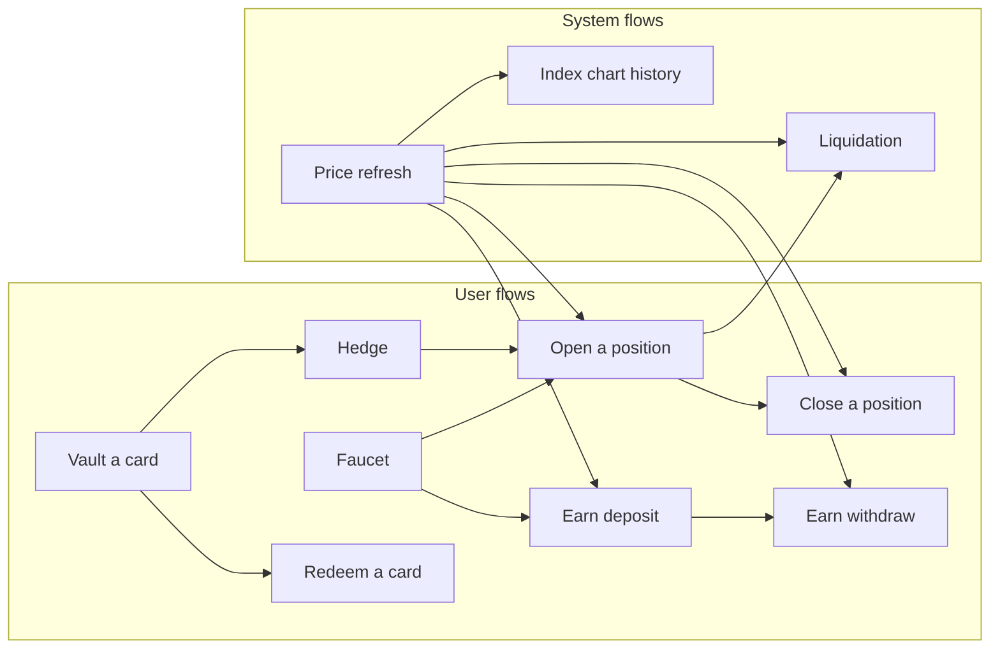

Every flow that reads a price needs a fresh one. A user transaction never waits for the keeper: when the stored price is older than half of `max_staleness_secs`, the web app prepends `refresh_price` to the same transaction (`refreshIfAging` in `apps/web/lib/tx.ts`).

## Open a position

Entry points: the trade ticket on `/`, `openPosition` in `lib/actions.ts`, `sendOpenPosition` in `lib/tradeTx.ts`.

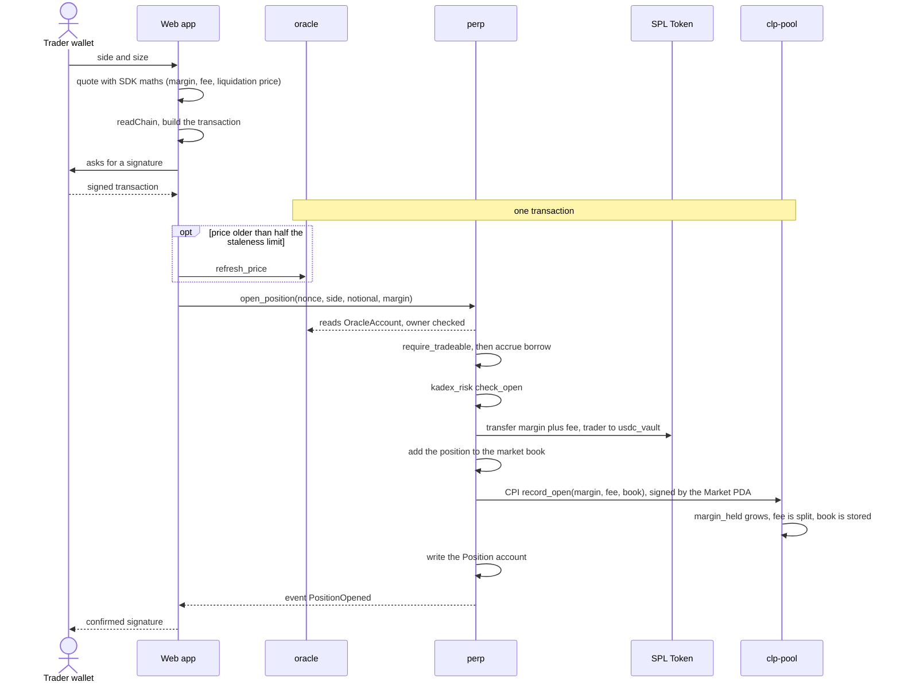

- The nonce is the current time in milliseconds. It is part of the Position PDA seeds, so one wallet can hold many positions.
- Margin must be at least `notional / 5`. The ticket sends exactly that.
- The fee is 0.10% of notional, rounded up.
- The entry price is the oracle price. There is no slippage parameter because the trade does not move a pool.
- An open that would pass either open-interest ceiling, or take utilization to 95%, is refused in the same transaction. Rules: [programs.md](programs.md#the-rules-that-can-refuse-an-open).

## Close a position

Entry points: the positions table, `closePosition` in `lib/actions.ts`, `sendClosePosition` in `lib/tradeTx.ts`.

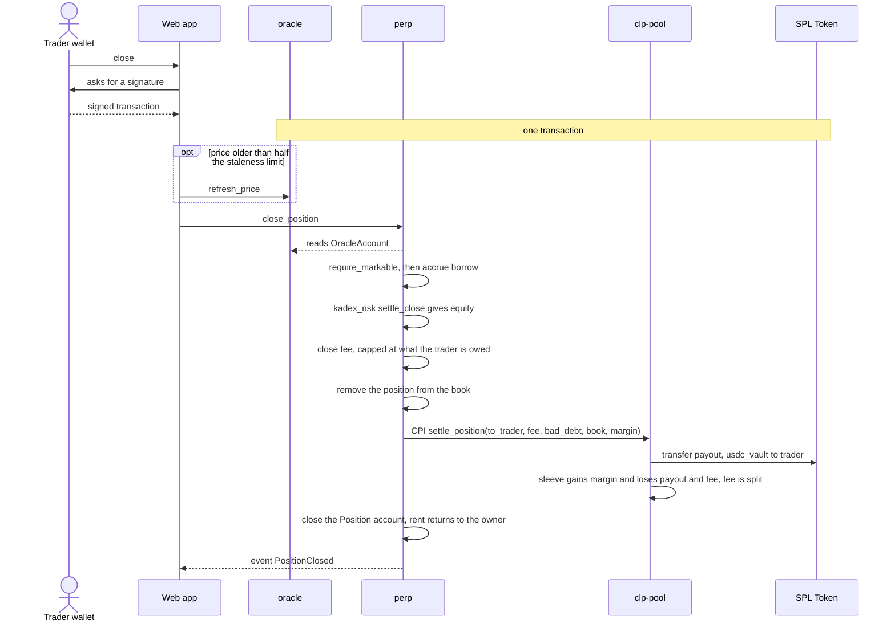

- Payout = margin + PnL − borrow owed − close fee, never below zero.
- Closing works in every market state and in every oracle state, as long as the price is fresh.
- If equity is negative the trader receives nothing and the shortfall is recorded in `Pool.bad_debt`.
- If the payout is larger than the sleeve can cover, `settle_position` fails with `PayoutExceedsSleeve` and the position stays open.

## Liquidation

Actor: `apps/liquidator`, or anyone else. `liquidate` is permissionless and pays its caller.

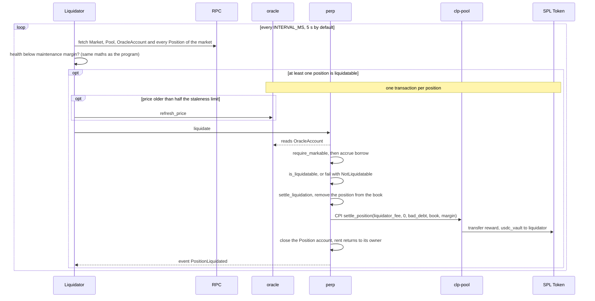

How the margin is split:

| Equity at liquidation | Liquidator receives | Stays in the pool | Bad debt recorded |
|---|---|---|---|
| Positive | min(1% of notional, equity) | margin − reward | 0 |
| Zero or negative | min(1% of notional, margin) | margin − reward | the negative equity |

With 5x leverage and a 6.25% maintenance margin, a position opened at maximum leverage becomes liquidatable after a move of 13.75% against it, before borrow. The oracle's move cap means the official price reaches that level some time after the AMM does. See [oracle.md](oracle.md).

## Price refresh

Actor: `apps/keeper`, the price mover, or any transaction that prepends the instruction.

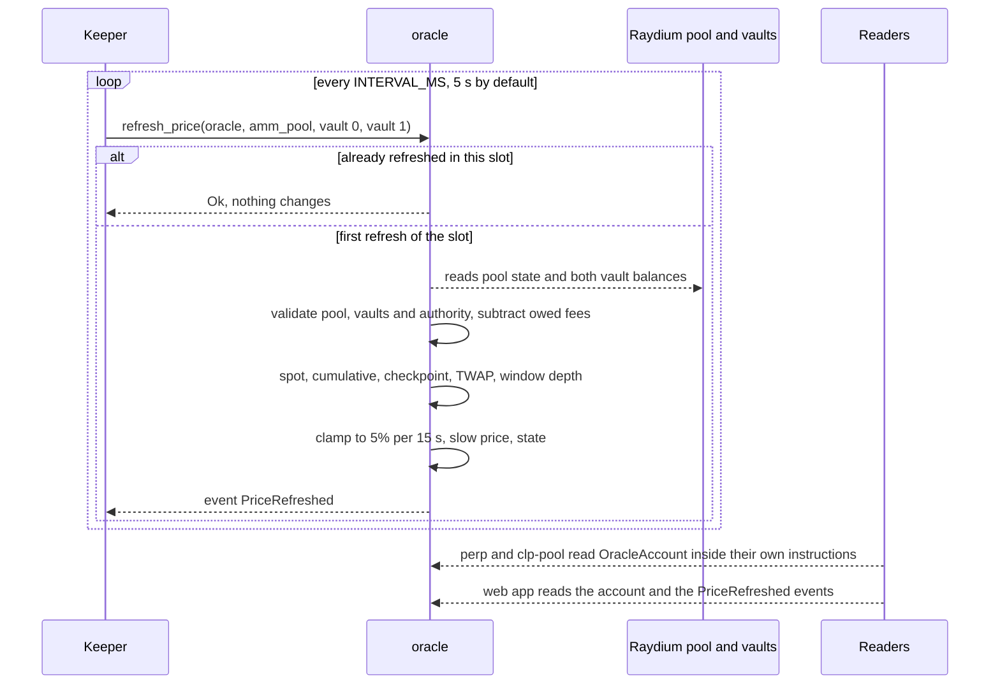

Steps inside the instruction: [programs.md](programs.md#what-refresh_price-computes).

On devnet a second process trades in the Raydium pool so the index moves. `scripts/devnet-market.mjs swing` swaps `tKDX` and `kdUSD` on a sine wave, and every swap carries `refresh_price` in the same transaction.

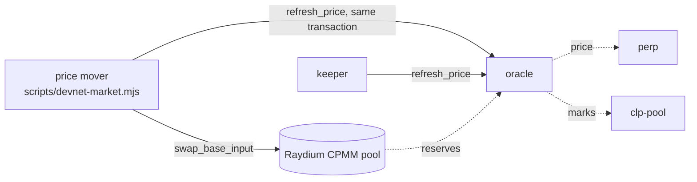

If every refresher stops, the price ages past `max_staleness_secs`. Opening is then refused. Close, liquidate, deposit and withdraw also refuse a stale price, and each can carry its own `refresh_price`.

## Earn deposit

Entry points: `/pool`, `poolAction` in `lib/actions.ts`, `sendPoolAction` in `lib/poolTx.ts`.

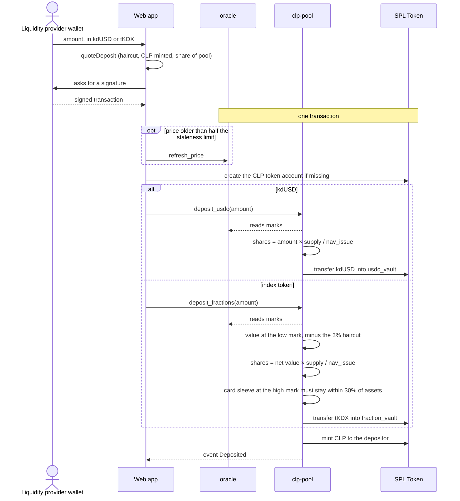

- The pool accepts its stable mint and its one fraction mint: `kdUSD` and `tKDX` on devnet. Details: [programs.md](programs.md#what-the-pool-accepts).
- Deposits are allowed only in state `Active`.
- A deposit too small to mint one base unit of CLP fails with `DustDeposit`.

## Earn withdraw

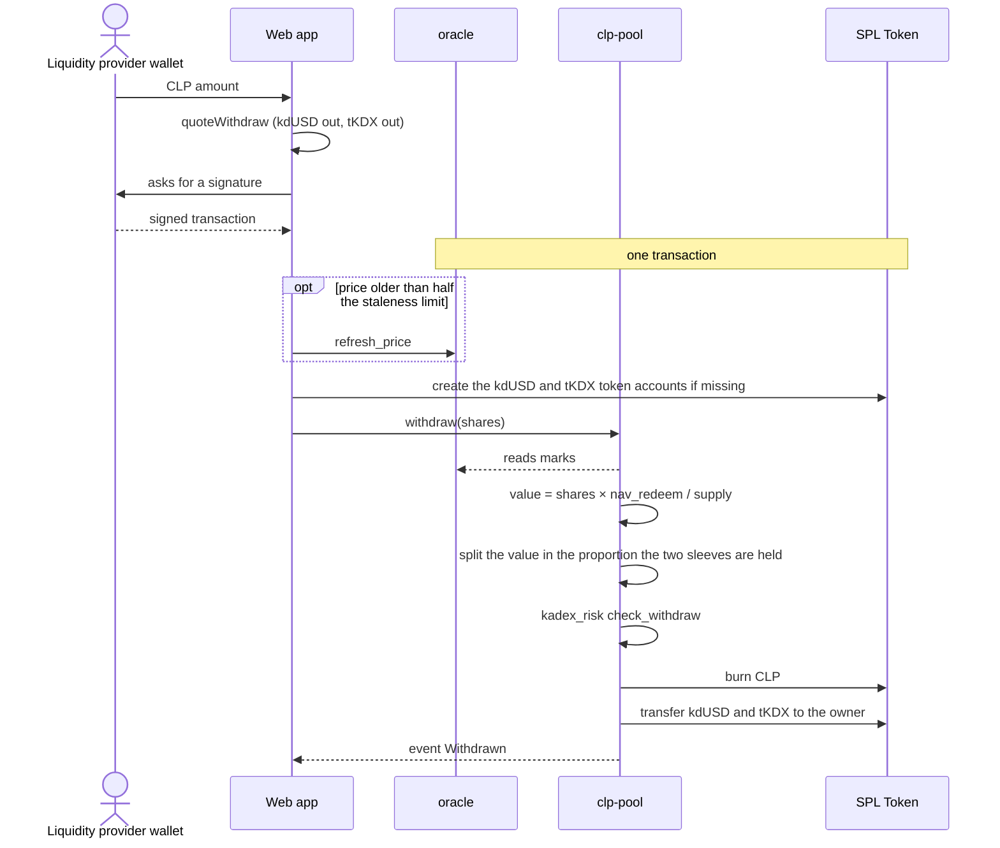

- A withdrawal always returns both assets in proportion. There is no stable-only exit.
- `check_withdraw` refuses a withdrawal that would leave open interest above the solvency ceiling of the remaining sleeve (`WithdrawBreachesCapacity`).
- In state `Settled` the instruction is `redeem_settled`: the same NAV-sized slice, with no capacity check.

## Vault a card

Precondition: the registry admin has whitelisted the card with `whitelist_core_card`, which fixes `fractions_per_card` from the appraisal and creates the card's fraction mint.

Entry points: `/vault/[address]`, `VaultActions`, `sendVaultAction` in `lib/vaultTx.ts`.

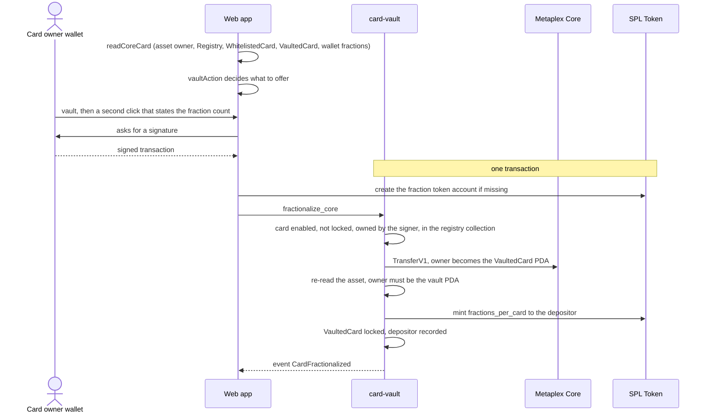

`vaultAction` in `@kadex/sdk` returns one of `vault`, `redeem`, `redeemShort`, `notOwner`, `notWhitelisted`, `disabled` or `missing`. It mirrors the program's checks, so the button is never enabled for a transaction the program would refuse.

## Redeem a card

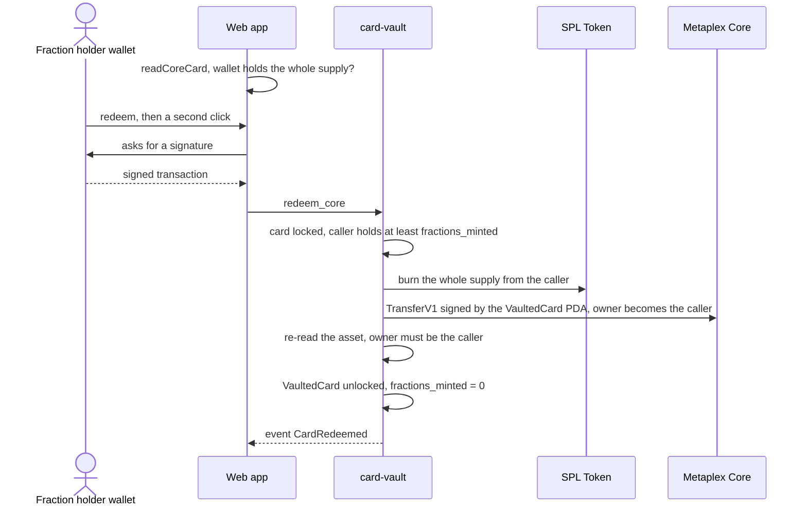

There is no partial redemption. A wallet that sold fractions has to hold all of them again before the card comes back. The Vault page lists, per locked card, how many fractions a wallet holds and how many are missing (`readVaultInventory`).

## Hedge

Hedge mode is the trade ticket with the short side fixed and the size derived from card inventory. It sends the same `open_position`.

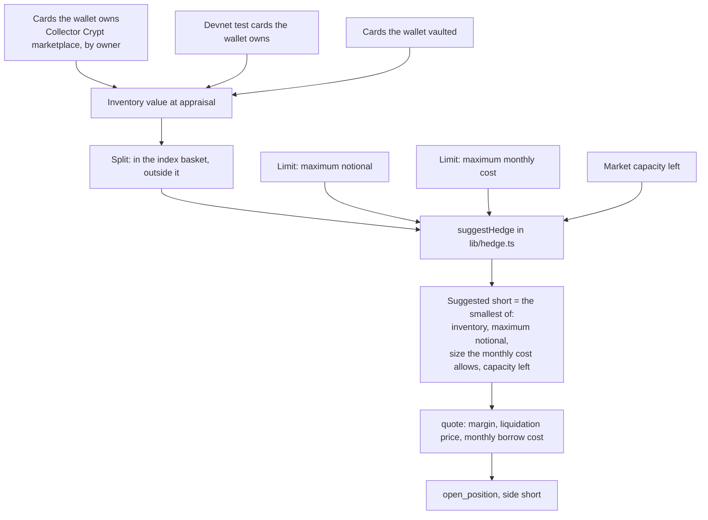

In hedge mode the number typed in the ticket is inventory value, and a cover slider (60% by default) sets the share of it to short. The suggestion fills the ticket with its own size. The monthly cost is the short side's hourly borrow rate times 720 hours, applied to the notional.

## Faucet

On devnet a wallet that connects receives test SOL and `kdUSD`.

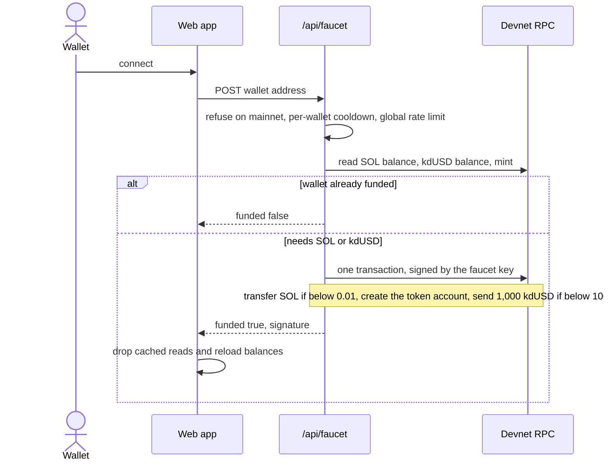

The route never runs on mainnet: it checks the configured network and the cluster's genesis hash. Limits: one grant per wallet per 60 seconds and 40 grants per 10 minutes.

## Index chart history

No account stores past prices. The chart is rebuilt from `PriceRefreshed` events.

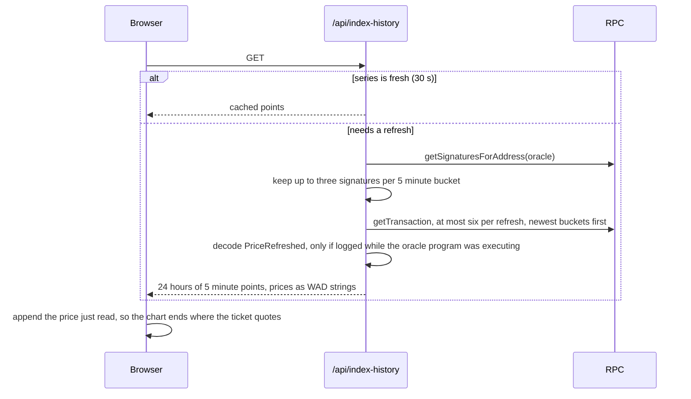

The web app also polls the market state every 10 seconds (`lib/useMarket.ts`) and shares identical reads for 3 seconds (`lib/chain.ts`).

## Where to go next

- [programs.md](programs.md): the instructions these flows call.
- [web-app.md](web-app.md): the modules that build these transactions.
- [services.md](services.md): the keeper, the liquidator and the price mover.
- [invariants.md](invariants.md): the rules every flow respects.
- [Docs index](README.md)
