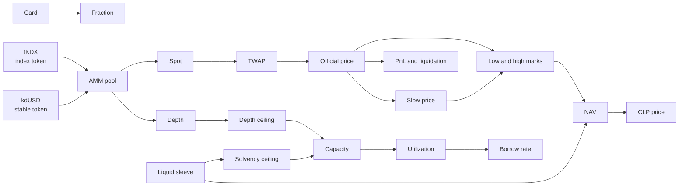

# Glossary

> [Docs](README.md) › Glossary · Up: [Docs index](README.md) · Related: [Overview](overview.md), [Programs](programs.md), [Invariants](invariants.md)

Every term, token and unit used in the code and in these documents. Names in `code font` are identifiers you can search for in the repository.

## How the terms relate

## Tokens

| Term | Meaning |
|---|---|
| `kdUSD` | "Kadex Devnet USD". The stable token on devnet: a 6-decimal SPL mint whose mint authority is the deployer. It is the margin and settlement token. It is a devnet test token and is not USDC. |
| `tKDX` | "Kadex Card Index (devnet test)". The index token on devnet: a 6-decimal SPL mint whose mint authority is the deployer. It trades against `kdUSD` in the Raydium CPMM pool, and that pool is the price source. Card backing arrives with the index token of the roadmap. |
| CLP | The pool's share token. Minted on deposit, burned on withdrawal. Its mint authority is the Pool PDA. |
| Fraction | A fungible SPL token minted by `card-vault` against one locked card. 6 decimals. One fraction per dollar of appraisal. Each card has its own fraction mint. |
| Stable token | The token margin is posted in. The programs name it `usdc_*` (`usdc_mint`, `usdc_vault`, `usdc_sleeve`). On devnet it is `kdUSD`. |

## Units and scales

| Term | Meaning |
|---|---|
| WAD | 1e6. The scale of prices, ratios and parameters. A price of 1.0 is stored as `1_000_000`. |
| BPS | 1e4. Basis points, used for configured fees and the haircut. |
| RAY | 1e12. The scale of the cumulative borrow index. |
| Base unit | The smallest unit of a token. Every token here has 6 decimals, so 1 token is `1_000_000` base units, and a WAD price times a base-unit quantity is a base-unit amount of the stable token. |
| `BigInt` | The TypeScript type for every amount. Conversion to `Number` is for display only. |

## Product

| Term | Meaning |
|---|---|
| Kadex Index | The single instrument traders go long or short on. Its price is the oracle's official price. |
| Trade | The side where positions are opened and closed. Program: `perp`. |
| Earn | The side where liquidity providers deposit into the pool. Program: `clp-pool`. |
| Vault | The side where a card is locked for fractions. Program: `card-vault`. |
| Hedge mode | The trade ticket with the short side fixed and the size derived from card inventory value. |
| Launch basket | The ten Collector Crypt cards in `deployments/basket.json`, selected by written rules, with a weight each. |
| Constituent | One card of the basket. `CONSTITUENTS` in `apps/web/lib/market.ts`. |

## Price

| Term | Meaning |
|---|---|
| AMM pool | The constant-product pool the oracle reads. On devnet: a Raydium CPMM pool pairing `tKDX` and `kdUSD`. |
| Spot | `stable reserve / index reserve` of the AMM pool at one refresh. |
| TWAP | Time-weighted average of the spot over `twap_window_secs` (30 minutes), computed from a running integral. |
| Official price | `OracleAccount.price`: the TWAP after the move cap. The price of PnL, liquidation and marking. |
| Clamp, move cap | The limit on how far the official price may move: `max_tick_move` (5%) per `clamp_period_secs` (15 s) of elapsed time. |
| Slow price | `OracleAccount.slow_twap`: a slow average of the official price. Used only to mark the pool's index token holdings. |
| Low mark, high mark | `min(price, slow price)` and `max(price, slow price)`. Value leaving the pool is priced at the low mark. CLP being issued is priced at the high mark. |
| Depth | `OracleAccount.depth_usdc`: the AMM's stable reserve, as the minimum over the window. |
| External reference | `external_median`: an off-chain reference published by the external feed. A sanity bound, never a price source. |
| `refresh_price` | The permissionless instruction that recomputes all of the above. |
| Oracle state | `Ok`, `Stale`, `ShallowDepth`, `Diverged`, `Uninitialized` or `CatchingUp`. Only `Ok` allows a position to be opened. |
| Fresh | A price refreshed within `max_staleness_secs` (900 s). Checked at read time by every consumer. |

## Pool

| Term | Meaning |
|---|---|
| Pool | The `clp-pool` account that is counterparty to every trade. |
| Liquid sleeve | `Pool.usdc_sleeve`: the liquidity providers' balance of the stable token. Winning traders are paid from it. |
| Card sleeve | `Pool.fraction_balance`: the pool's holdings of its fraction mint (`tKDX` on devnet), stored as a quantity and valued at read time. |
| Margin held | `Pool.margin_held`: trader margin sitting in the pool's vault, kept apart from the sleeve. |
| NAV | Net asset value of the pool. `nav_redeem` prices withdrawals, `nav_issue` prices deposits, and `nav_issue` is never lower. |
| CLP price | `NAV / CLP supply`. 1.0 for an empty pool. |
| Haircut | The 3% deduction on a deposit of index tokens (`deposit_haircut_bps`). It stays in the pool, to the benefit of existing holders. |
| Card sleeve target | The largest share of pool assets the card sleeve may reach through deposits: 30%. |
| Bad debt | A loss beyond a position's margin. Recorded in `Pool.bad_debt`. |
| Protocol fees | The share of open and close fees not paid to liquidity providers (25%), held in the vault until `claim_protocol_fees`. |
| Book | `BookSnapshot`: open interest, units and borrow data per side, pushed by `perp` to the pool so NAV can count open positions. |

## Positions

| Term | Meaning |
|---|---|
| Position | One long or short, with its own margin. A `perp` account per position. |
| Notional | The size of a position in the stable token. |
| Margin | The collateral of a position. At least `notional / 5`. |
| Leverage | `notional / margin`. At most 5x. |
| Entry price | The official price when the position opened. |
| PnL | Profit or loss at the official price: `notional × (price − entry) / entry` for a long, the opposite for a short. |
| Borrow | The hourly cost of holding a position, paid to the pool. Tracked by a cumulative index per side. |
| Equity | `margin + PnL − borrow owed`. |
| Health | `equity / notional`. |
| Maintenance margin | 6.25%. A position whose health is below it can be liquidated. |
| Liquidation price | The price at which health reaches the maintenance margin. Known when the position opens. |
| Liquidation | Closing someone else's position once it is below maintenance. Permissionless. The caller receives 1% of notional. |
| Open interest (OI) | The sum of open notional, per side and in total. |
| Capacity | The open interest the market accepts: the lower of the solvency ceiling and the depth ceiling. |
| Solvency ceiling | `usdc_sleeve × phi / delta_max`: what the liquid sleeve can pay. |
| Depth ceiling | `depth × (sqrt(1 + delta_liq) − 1) / (mu × attack_safety)`: sized so that pushing the AMM price far enough to force liquidations costs more than it pays. |
| Utilization | `open interest / capacity`. New positions stop at 95%. |
| Crowded side | The side with more open interest. It pays a higher borrow rate. |

## Market states

| Term | Meaning |
|---|---|
| `Active` | Open, close, liquidate, deposit and withdraw are allowed. |
| `ReduceOnly` | Close and liquidate only. |
| `Settled` | The market is over. Positions close, liquidations clear and holders redeem with `redeem_settled`. Nothing leaves this state. |

## Cards

| Term | Meaning |
|---|---|
| Graded card | A physical trading card certified and sealed by a grading company such as PSA, BGS or CGC. |
| Slab | The sealed case a graded card sits in. |
| Collector Crypt | The marketplace that tokenizes graded cards on Solana. Kadex reads its public API and its on-chain collection. |
| Metaplex Core asset | The NFT standard Collector Crypt mints cards in. One account per asset, with the owner as a field. |
| Appraisal | Collector Crypt's `insuredValue` for a card. It fixes how many fractions the card mints. |
| Whitelist | The admin step that allows a card into the vault and fixes `fractions_per_card` and `weight_bps`. |
| Registry | The `card-vault` account holding the admin and the collection whose cards may be whitelisted. |
| Collection | The Metaplex Core collection a card belongs to. The vault only accepts cards of the registry's collection. |
| Test card | On devnet, a copy of a Collector Crypt card minted into a devnet collection and whitelisted at the original's appraisal. |

## Operations

| Term | Meaning |
|---|---|
| Keeper | The process that calls `refresh_price` on a loop. |
| Liquidator | The process that scans positions and sends `liquidate`. |
| Price mover | The devnet process that trades in the Raydium pool so the index moves. |
| External feed | The process that publishes the external reference. |
| Faucet | The web app route that sends test SOL and `kdUSD` to a connecting wallet on devnet. |
| Demo wallet | A wallet built into the web app off mainnet. Its key is generated and kept in the browser. |
| PDA | Program derived address. An account address computed from seeds and a program ID. |
| Upgrade authority | The key that can replace a program's code. Every `initialize_*` requires it. The deployer on devnet. |
| Admin | The key stored on an oracle, pool or registry account. It can change parameters and whitelist cards. It cannot write a price. |
| Deployer | The key that deployed the programs. On devnet it is the upgrade authority, every admin and the mint authority of `kdUSD` and `tKDX`. |
| IDL | Anchor's interface description of a program. Committed in `deployments/idl`. |
| Devnet | Solana's public test cluster. Tokens there are test tokens. |

## Where to go next

- [overview.md](overview.md): the terms in context.
- [programs.md](programs.md): the fields and instructions behind these names.
- [invariants.md](invariants.md): the formulas in full.
- [Docs index](README.md)
