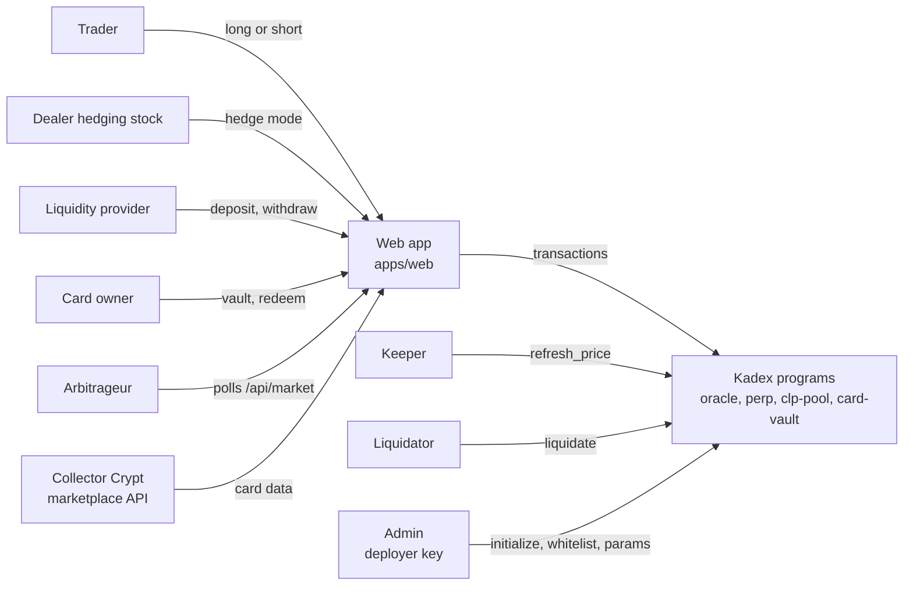
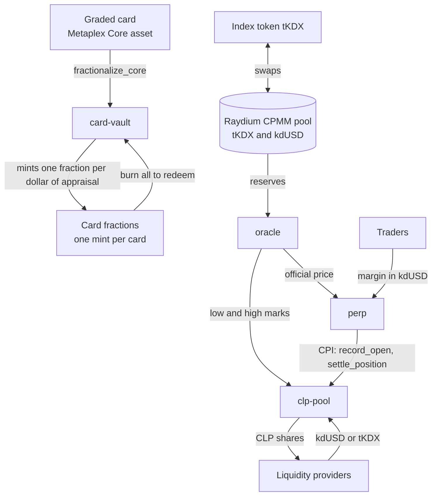

# Overview

> [Docs](README.md) › Overview · Up: [Docs index](README.md) · Related: [System map](system-map.md), [Users](users.md), [Glossary](glossary.md), [Spec](spec.md)

## What Kadex is

Kadex is a perpetual futures market for graded trading cards, on Solana. One index, the Kadex Index, stands for the card market. A trader goes long or short on it with leverage. A shared liquidity pool takes the other side of every trade. A card owner locks a graded card in a vault and receives fractions worth its appraised value.

A collector can own a card or sell it. Kadex adds the positions that were missing: a short, a leveraged long, and a hedge for someone who holds inventory.

The index price is not signed by anyone. A permissionless instruction, `refresh_price`, recomputes it from the reserves of an on-chain AMM pool. There is no oracle key.

Kadex is live on Solana devnet. See [devnet.md](devnet.md).

## The three sides

| Side | Screen | What the user does | Program |
|---|---|---|---|
| Trade | `/` | Opens a long or a short on the index with up to 5x leverage. Margin is posted in the stable token (`kdUSD` on devnet). The ticket shows margin, fee, entry price and liquidation price before signing. | `perp` |
| Earn | `/pool` | Deposits `kdUSD` or the index token `tKDX` and receives CLP shares. The pool is the counterparty to every trade and collects trading fees and borrow. A withdrawal returns a proportional slice of both assets. | `clp-pool` |
| Vault | `/vault` | Locks a whitelisted graded card and receives a fixed number of fractions, one per dollar of appraisal. Returning every fraction releases the card. | `card-vault` |

A fourth screen, Portfolio (`/portfolio`), shows a wallet's positions, CLP shares and vaulted cards in one place.

## Actors

| Actor | Role | Where it is served |
|---|---|---|
| Trader | Directional exposure without owning a card | Trade ticket, Portfolio |
| Dealer | Protects the value of card inventory with a short | Hedge mode in the trade ticket |
| Liquidity provider | Earns fees for being the counterparty | Earn |
| Card owner | Turns a graded card into fractions | Vault |
| Arbitrageur | Trades the gap between the long and short borrow rates | Both rates in the ticket, `/api/market` |
| Keeper | Calls `refresh_price` on a loop | [services.md](services.md#keeper) |
| Liquidator | Liquidates positions below maintenance margin, for a reward | [services.md](services.md#liquidator) |
| Admin | Initializes accounts, whitelists cards, sets parameters | [upgrade-authority.md](upgrade-authority.md) |

The roles are described in depth in [users.md](users.md).

## How the sides connect

Read it as two halves that share one price.

- **Card half.** `card-vault` turns a card into fractions and back. Each card has its own fraction mint.
- **Market half.** The index token `tKDX` trades against `kdUSD` in a Raydium CPMM pool. The `oracle` program turns that pool's reserves into the official price. `perp` settles positions at that price. `clp-pool` is bound to one stable mint and one fraction mint, which on devnet are `kdUSD` and `tKDX`, so those are the two assets Earn accepts.

The link between the halves, an index token backed by vaulted cards, is the first item of the [roadmap](#roadmap).

## Main parameters

Values on devnet. The pool parameters equal `PoolParams::default()` in [`kadex-interface`](../packages/kadex-interface/src/lib.rs). The oracle parameters are set in [`scripts/devnet.mjs`](../scripts/devnet.mjs).

| Parameter | Value | Field |
|---|---|---|
| Maximum leverage | 5x | `base_leverage` |
| Maintenance margin | 6.25% of notional | `maintenance_margin` |
| Open and close fee | 0.10% of notional | `open_close_fee_bps` = 10 |
| Liquidator reward | 1% of notional | `liquidator_fee_bps` = 100 |
| Fee share paid to liquidity providers | 75% | `lp_fee_share_bps` = 7500 |
| Borrow rate per hour | 0.005% + 0.05% × utilization² | `r0`, `r1` |
| Crowded side surcharge | up to +50% of the rate | `psi` = 0.5 |
| Haircut on index token deposits | 3% | `deposit_haircut_bps` = 300 |
| Card sleeve target | 30% of pool assets | `card_sleeve_target` |
| Utilization that stops new positions | 95% | `reduce_only_utilization` |
| TWAP window | 30 minutes | `twap_window_secs` = 1800 |
| Price move cap | 5% per 15 seconds of elapsed time | `max_tick_move`, `clamp_period_secs` |
| Minimum AMM depth | 25,000 kdUSD over the window | `min_pool_depth` |
| Price staleness limit | 900 seconds | `max_staleness_secs` |
| Divergence bound against the external reference | 15% | `max_divergence` |

The two open-interest ceilings and the rules behind these numbers are in [invariants.md](invariants.md).

## What is live

| Piece | State |
|---|---|
| `oracle`, `clp-pool`, `perp`, `card-vault` | Deployed on Solana devnet on 12 Oct 2026 |
| Price source | A Raydium CPMM pool pairing `tKDX` and `kdUSD` |
| Web app | Hosted, wired to devnet, with a built-in demo wallet and a faucet |
| Keeper, liquidator, price mover | Hosted services running against devnet |

Addresses and how to try it: [devnet.md](devnet.md).

## Roadmap

Planned work, in order.

1. **Index token backed by vaulted cards.** A basket mint that holds the weighted card fractions and is redeemable for them, so a card's fractions can enter the Earn pool. Tracked as [issue #1](https://github.com/kadex-protocol/Kadex/issues/1).
2. **Vault the launch basket.** The ten Collector Crypt cards selected by rule in [`deployments/basket.json`](../deployments/basket.json), bought and vaulted by the protocol treasury.
3. **Split the admin roles on chain.** A feed authority for the external reference, an admin rotation instruction and a pause authority. See [upgrade-authority.md](upgrade-authority.md).
4. **Multisig with a timelock as upgrade authority**, with verifiable builds.
5. **Mainnet readiness.** Fresh program keypairs, an audit and a legal review. See [regulatory.md](regulatory.md).
6. **Stop-loss and take-profit orders.**

## Where to go next

- [system-map.md](system-map.md): how programs, crates, packages and apps connect.
- [flows.md](flows.md): each flow step by step.
- [users.md](users.md): the five roles in depth.
- [spec.md](spec.md): the full design in prose.
- [Docs index](README.md)
