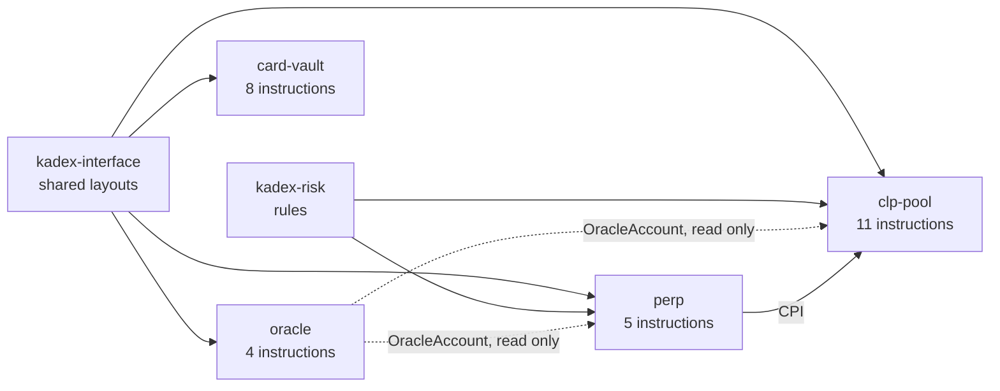
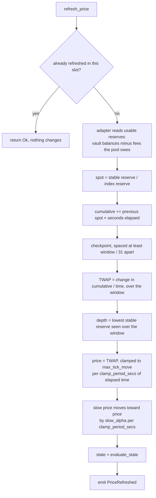
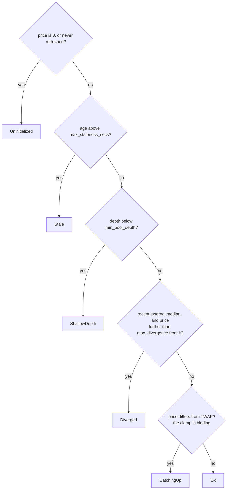
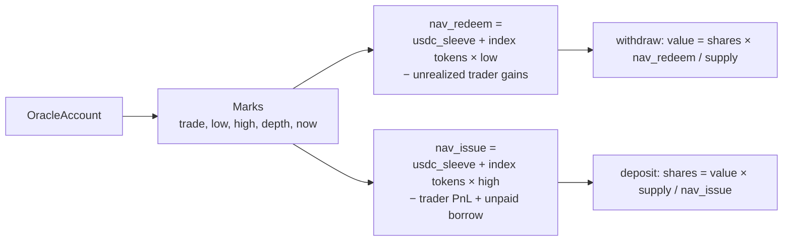
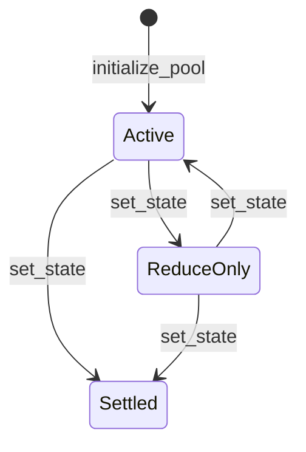
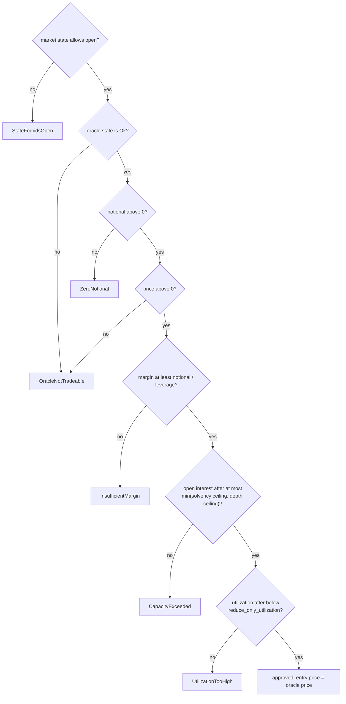

# Programs

> [Docs](README.md) › Programs · Up: [System map](system-map.md) · Related: [Oracle](oracle.md), [Invariants](invariants.md), [Custody](custody.md), [Upgrade authority](upgrade-authority.md), [Flows](flows.md)

Reference for the four Anchor programs: instructions, accounts, PDA seeds, events and errors. Everything here is read from `programs/*/src` and `packages/kadex-interface/src/lib.rs`. Anchor 1.2, Rust 1.89.

| Program | ID | Source |
|---|---|---|
| [`oracle`](#oracle) | `5288ShBXsFxqXiGm22FZi1ZrMnmet4i1ZR3bccyAguqp` | [`programs/oracle/src`](../programs/oracle/src) |
| [`clp-pool`](#clp-pool) | `3XZkAqLeQDoNXD6Bb9YoGSEdnvqk9r7UMgrKsN5x3L9v` | [`programs/clp-pool/src`](../programs/clp-pool/src) |
| [`perp`](#perp) | `BcVwJ91Jd1k7xUNcGYzRygq2ubaCYn7p5MeUZzy1EyLR` | [`programs/perp/src`](../programs/perp/src) |
| [`card-vault`](#card-vault) | `J8Tef8N4YSfVwAxpBemCZrz3qCxehTeb2cd1jTwoBczW` | [`programs/card-vault/src`](../programs/card-vault/src) |

The IDs are fixed by the keypairs in `keys/` and are the same on a local validator and on devnet. The IDLs are in [`deployments/idl`](../deployments/idl).

Every handler follows one shape: Anchor validates the accounts, the handler calls one function in `kadex-risk`, moves tokens, writes state and emits an event. The handler decides nothing.

Note for readers of the code: `programs/mock-amm` is the constant-product AMM used by the local validator test suite, while devnet prices come from the Raydium CPMM pool.

## oracle

Reads the reserves of an AMM pool and publishes one official price. It signs nothing with an off-chain key.

### Instructions

| Instruction | Who may call | What it does |
|---|---|---|
| `initialize(adapter, params)` | The program's upgrade authority | Creates the `OracleAccount` for a basket. Validates the parameters and checks that the AMM pool is genuine and pairs the basket mint. State starts as `Uninitialized`. |
| `refresh_price()` | Anyone | Reads the reserves and republishes price, TWAP, slow price, depth and state. A second call in the same slot succeeds and changes nothing. For a Raydium pool the two vaults are passed as remaining accounts. |
| `set_external_median(median)` | The oracle `admin` | Stores the external reference and its timestamp, then re-evaluates the state. |
| `set_params(params)` | The oracle `admin` | Replaces the parameters after the same validation as `initialize`. |

### What `refresh_price` computes

The first refresh publishes the spot as price and TWAP. On devnet `slow_alpha` is 0.01 (set in `scripts/devnet.mjs`).

### How the state is decided

`evaluate_state` checks in this order and returns the first match.

Only `Ok` allows a position to be opened. The divergence check applies while an external median newer than `max_staleness_secs` exists. Consumers also check freshness against the clock at read time, because the stored state only changes on a refresh.

### Account: `OracleAccount`

PDA with seeds `"oracle"`, basket mint. 1265 bytes. Declared in `kadex-interface`, written only by `oracle`.

| Field | Type | Meaning |
|---|---|---|
| `basket` | `Pubkey` | The basket this oracle prices. For a Raydium pool it is the index token mint, and it decides which side of the pool is the stable token. |
| `amm_pool` | `Pubkey` | The AMM pool account the reserves are read from. |
| `adapter` | `AmmAdapter` | Which pool layout to read. `Raydium` on devnet. |
| `admin` | `Pubkey` | May change parameters and set the external median. Cannot write a price. |
| `price` | `u64` WAD | The official price, TWAP and clamp applied. Used for PnL and liquidation. |
| `twap` | `u64` WAD | Window TWAP before the clamp. |
| `spot` | `u64` WAD | Last spot read from the AMM. |
| `cumulative` | `u128` | Running integral of spot × seconds. |
| `slow_twap` | `u64` WAD | Slow average of the price, used only to mark the pool's index token holdings. |
| `depth_usdc` | `u64` | Stable reserve of the AMM, as the minimum over the window. Feeds the depth ceiling. |
| `last_update_ts`, `last_update_slot` | `i64`, `u64` | When the last effective refresh happened. |
| `external_median`, `external_ts` | `u64` WAD, `i64` | The external reference and when it was set. |
| `params` | `OracleParams` | `twap_window_secs`, `max_tick_move`, `max_staleness_secs`, `min_pool_depth`, `max_divergence`, `slow_alpha`, `clamp_period_secs`. |
| `state` | `OracleState` | Result of `evaluate_state` at the last refresh. |
| `observations`, `obs_head`, `obs_len` | 32 × `Observation` | Ring buffer of checkpoints: `ts`, `cumulative`, `depth`. |
| `bump` | `u8` | PDA bump. |

### The Raydium CPMM adapter

`programs/oracle/src/adapter.rs` trusts nothing the caller passes. It requires that the pool is owned by Raydium CPMM (mainnet or devnet program), is a 637-byte `PoolState`, pairs two 6-decimal classic SPL tokens with swaps enabled, and pairs the basket mint. Each vault must be the one the pool records, hold that side's mint, be initialized and be owned by Raydium's authority PDA. Usable reserves are the vault balances minus the protocol, fund and creator fees the pool owes. The full table of checks is in [oracle.md](oracle.md).

### Event

| Event | Fields |
|---|---|
| `PriceRefreshed` | `oracle`, `spot`, `twap`, `price`, `depth_usdc`, `state`, `ts` |

The web app's price chart is built from these events. See [flows.md](flows.md#index-chart-history).

### Errors: `OracleError`

`EmptyPool`, `PriceOverflow`, `NoObservations`, `WrongAmmPool`, `NotAdmin`, `BadParams`, `AdapterUnsupported`, `AdapterBadAccount`, `AdapterWrongVault`, `AdapterWrongMint`, `AdapterWrongAuthority`, `AdapterUnsupportedToken`, `AdapterPoolDisabled`, `AdapterInsufficientVault`.

## clp-pool

The pool is the counterparty to every trade. It holds two assets with separate jobs:

- the **liquid sleeve** (`usdc_sleeve`), in the pool's stable token: it pays winning traders, withdrawals and liquidation rewards
- the **card sleeve** (`fraction_balance`), in the pool's fraction mint: it gives the pool exposure to the index and never pays a winning trader

The program names its stable token `usdc_*`. On devnet that mint is `kdUSD` and the fraction mint is the index token `tKDX`.

### What the pool accepts

| Instruction | Token required | Check in the program |
|---|---|---|
| `deposit_usdc` | The pool's `usdc_mint` | `depositor_usdc.mint == pool.usdc_mint` |
| `deposit_fractions` | The pool's `fraction_mint` | `depositor_fractions.mint == pool.fraction_mint` |

Both mints are bound at `initialize_pool` and no instruction rebinds them. The fraction mint of a vaulted card is a different mint, one per card, so the pool refuses it with `WrongMint`. An index token backed by vaulted cards is planned work, tracked as [issue #1](https://github.com/kadex-protocol/Kadex/issues/1).

### Instructions

| Instruction | Who may call | What it does |
|---|---|---|
| `initialize_pool(params)` | The program's upgrade authority | Creates the `Pool`. Checks that the CLP mint is empty, unfreezable and minted only by the pool, that both vaults hold the right mints and are owned by the pool with no delegate or close authority, and that the oracle account is real. |
| `deposit_usdc(amount)` | Anyone, state `Active` | Transfers the stable token in and mints CLP at the issue NAV. Rounds down. |
| `deposit_fractions(amount)` | Anyone, state `Active` | Values the tokens at the low mark, subtracts the haircut, mints CLP at the issue NAV. Refused if the card sleeve would pass `card_sleeve_target`. |
| `withdraw(shares)` | A CLP holder, state `Active` | Burns CLP and pays its value at the redeem NAV as a proportional slice of both sleeves. Refused if open interest would exceed the solvency ceiling of the remaining sleeve. |
| `redeem_settled(shares)` | A CLP holder, state `Settled` | The same NAV-sized slice once the market is settled, with no capacity gate. |
| `record_open(margin, fee, book)` | CPI only, signed by the registered Market PDA | Adds the margin to `margin_held`, splits the fee, stores the new book. |
| `settle_position(to_recipient, fee, bad_debt, book, margin_released)` | CPI only, signed by the registered Market PDA | Releases a position's margin, pays the recipient, splits the fee, records bad debt, stores the new book. Fails with `PayoutExceedsSleeve` if the sleeve cannot cover the payout: nothing is paid in part and the position stays open. |
| `set_perp_market(market)` | The pool `admin` | Binds the perp market. Only the PDA the perp program derives for this pool is accepted. |
| `claim_protocol_fees(amount)` | The pool `admin` | Pays out up to `accrued_fees_protocol`. |
| `set_params(params)` | The pool `admin` | Replaces the economic parameters after validation. |
| `set_state(next)` | The pool `admin` | Changes the market state. Nothing leaves `Settled`. |

### NAV and CLP pricing

The pool reads three prices from a fresh oracle: `trade` (the official price), `low` = min(price, slow price) and `high` = max(price, slow price).

`nav_issue` is never below `nav_redeem`, so a deposit followed by a withdrawal cannot come out ahead. The first deposit mints 1 CLP per unit of value. Trader margin and the protocol's fee share sit in `usdc_vault` but are not part of either NAV. Formulas and tests: [invariants.md](invariants.md).

### Market states

| State | Open | Close | Liquidate | Deposit | Withdraw | Final redemption |
|---|---|---|---|---|---|---|
| `Active` | yes | yes | yes | yes | yes | no |
| `ReduceOnly` | no | yes | yes | no | no | no |
| `Settled` | no | yes | yes | no | no | yes |

### Account: `Pool`

PDA with seeds `"pool"`, stable mint. 554 bytes.

| Field | Meaning |
|---|---|
| `admin` | May set parameters and state, bind the market, claim protocol fees. |
| `usdc_mint`, `clp_mint`, `usdc_vault` | The stable mint, the share mint and the vault holding the stable token. |
| `fraction_mint`, `fraction_vault` | The one fraction mint the pool accepts and its vault. |
| `oracle` | The `OracleAccount` this pool marks against. |
| `perp_market` | The single Market PDA allowed to call `record_open` and `settle_position`. |
| `usdc_sleeve` | Liquidity providers' stable balance. Winners are paid from here. |
| `fraction_balance` | The card sleeve as a token quantity, valued at read time. |
| `clp_supply` | CLP in circulation. |
| `book` | `BookSnapshot` pushed by `perp` on every open and settle: open interest, units, borrow indices and borrow units per side, last accrual time. |
| `bad_debt` | Losses past a position's margin. Recorded for visibility, not deducted from NAV. |
| `margin_held` | Trader margin in `usdc_vault`, held apart from the sleeve. |
| `accrued_fees_lp` | Running total of the liquidity providers' fee share, already in the sleeve. |
| `accrued_fees_protocol` | The protocol's fee share, in the vault until claimed. |
| `params` | `PoolParams`, 17 fields. Values in [overview.md](overview.md#main-parameters). |
| `state` | `MarketState`. |
| `bump` | PDA bump. |

### Events

| Event | Fields |
|---|---|
| `Deposited` | `pool`, `depositor`, `usdc`, `fractions`, `shares` |
| `Withdrawn` | `pool`, `owner`, `shares`, `usdc`, `fractions`, `price` |
| `Redeemed` | `pool`, `owner`, `shares`, `usdc`, `fractions`, `price` |
| `PositionSettled` | `pool`, `to_recipient`, `fee`, `bad_debt` |
| `StateChanged` | `pool`, `state` |

### Errors: `PoolError`

`NotAdmin`, `BadParams`, `CapacityExceeded`, `CardWeightExceeded`, `AlreadySettled`, `NotSettled`, `StateForbids`, `InsufficientLiquidity`, `NotPerpMarket`, `ZeroAmount`, `DustDeposit`, `Overflow`, `WrongOracle`, `WrongMint`, `WrongVault`, `NotOwner`, `SleeveTargetExceeded`, `Insolvent`, `PayoutExceedsSleeve`.

## perp

Long and short positions against the pool. There is no order book and no trader-to-trader matching. The pool rents out exposure and charges borrow by the hour.

### Instructions

| Instruction | Who may call | What it does |
|---|---|---|
| `initialize_market()` | The pool `admin` | Creates the `Market` for a pool, bound to the pool's own oracle. One market per pool. |
| `open_position(nonce, side, notional, margin)` | Anyone | Requires a fresh price in state `Ok`, accrues borrow, runs `check_open`, collects margin plus fee, records the position and tells the pool. |
| `accrue_borrow()` | Anyone | Advances both borrow indices. Open, close and liquidate accrue on their own, so nothing depends on this call. |
| `close_position()` | The position owner | Settles PnL at the oracle price minus borrow and the close fee, pays what is left, closes the account. |
| `liquidate()` | Anyone | Allowed once health is below the maintenance margin. Pays the caller the liquidator reward and closes the account. Rent goes back to the position owner. |

### The rules that can refuse an open

`kadex_risk::check_open` holds every one of them, in this order.

Before that function runs, the handler calls `require_tradeable`, which refuses a stale price with `OracleStale`.

The two ceilings:

- solvency: `usdc_sleeve × phi / delta_max`
- depth: `oracle depth × (sqrt(1 + delta_liq) − 1) / (mu × attack_safety)`

### Position maths

| Value | Formula |
|---|---|
| PnL, long | `notional × (price − entry) / entry` |
| PnL, short | `notional × (entry − price) / entry` |
| Borrow owed | `notional × (index now − index at entry) / index at entry` |
| Equity | `margin + PnL − borrow owed` |
| Health | `equity / notional` |
| Liquidatable | `health < maintenance_margin` |
| Liquidation price | entry moved against the position by `(margin − borrow) / notional − maintenance_margin` |
| Borrow rate per hour | `(r0 + r1 × utilization²) × (1 + psi × max(0, (own side − other side) / total))` |

The same functions exist in TypeScript in `@kadex/sdk` (`math`), held equal to the Rust by parity tests.

### Accounts

`Market`: PDA with seeds `"market"`, pool. 197 bytes.

| Field | Meaning |
|---|---|
| `pool`, `oracle` | The pool this market trades against and the oracle it reads. |
| `oi_long`, `oi_short` | Open interest per side, in stable token units. |
| `units_long`, `units_short` | Sum of `notional / entry price` per side, so the whole book is marked with one multiplication. |
| `borrow_idx_long`, `borrow_idx_short` | Cumulative borrow index per side, RAY scale. |
| `last_accrual_ts` | When the indices were last advanced. |
| `open_positions` | Count of open positions. |
| `borrow_units_long`, `borrow_units_short` | Sum of `notional × RAY / index at entry` per side, so the book's unpaid borrow is read with one multiplication. |
| `bump` | PDA bump. |

`Position`: PDA with seeds `"position"`, market, owner, nonce. 130 bytes.

| Field | Meaning |
|---|---|
| `owner`, `market` | Who owns it and where. |
| `side` | `Long` or `Short`. |
| `notional`, `margin` | Size and collateral, in stable token units. |
| `entry_price` | The oracle price at open, WAD. |
| `borrow_idx_entry` | The side's borrow index at open. |
| `opened_ts`, `nonce`, `bump` | Open time, the caller-chosen nonce, PDA bump. |

### Events

| Event | Fields |
|---|---|
| `PositionOpened` | `position`, `owner`, `side`, `notional`, `margin`, `entry_price`, `fee`, `oi_after`, `cap` |
| `PositionClosed` | `position`, `owner`, `price`, `to_trader`, `fee`, `bad_debt` |
| `PositionLiquidated` | `position`, `owner`, `liquidator`, `price`, `liquidator_fee`, `to_pool`, `bad_debt` |

### Errors: `PerpError`

`StateForbidsOpen`, `StateForbidsClose`, `ZeroNotional`, `InsufficientMargin`, `CapacityExceeded`, `UtilizationTooHigh`, `NotLiquidatable`, `MathFailure`, `NotOwner`, `WrongOracle`, `WrongPool`, `WrongMint`, `WrongVault`, `WrongMarket`.

Refusals that come from `kadex-risk` or from the oracle view surface as `InterfaceError` codes. See [Shared interface](#shared-interface).

## card-vault

Locks a graded card and mints fungible SPL fractions against it. Redeeming requires returning all of that card's fractions. The program knows nothing about prices, pools or positions.

Invariant: fraction supply equals `fractions_per_card` while the card is locked, and `0` after redemption.

### Two custody paths

| Path | Card type | Lock | Unlock |
|---|---|---|---|
| Metaplex Core | A Core asset, the standard Collector Crypt mints | `fractionalize_core`: the `VaultedCard` PDA becomes the asset's owner through Core's `TransferV1`. The program re-reads the asset before minting. | `redeem_core` |
| SPL NFT | A mint with supply 1 | `fractionalize`: the token moves to an escrow token account owned by the `VaultedCard` PDA. | `redeem_card` |

The web app uses the Metaplex Core path.

### Instructions

| Instruction | Who may call | What it does |
|---|---|---|
| `initialize_registry(collection)` | The program's upgrade authority | Creates the `Registry` and stores the Core collection whose cards may be whitelisted. |
| `whitelist_core_card(fractions_per_card, weight_bps)` | The registry `admin` | Whitelists a Core asset that belongs to the registry's collection. Creates its `WhitelistedCard`, `VaultedCard` and fraction mint. |
| `whitelist_card(fractions_per_card, weight_bps)` | The registry `admin` | The same for an SPL NFT mint. |
| `fractionalize_core()` | The asset's owner | Requires the card enabled, not locked, owned by the signer and in the collection. Transfers the asset to the vault PDA and mints exactly `fractions_per_card` to the depositor. |
| `redeem_core()` | A holder of the whole supply | Burns `fractions_minted` from the caller and transfers the asset back, signed by the vault PDA. |
| `fractionalize()` | The NFT's holder | SPL NFT path of the same lock. |
| `redeem_card()` | A holder of the whole supply | SPL NFT path of the same unlock. |
| `set_card_enabled(enabled)` | The registry `admin` | A disabled card accepts no new deposit. A locked card can still be redeemed. |

Fractions have 6 decimals (`FRACTION_DECIMALS`), like the stable token. One fraction stands for one dollar of appraisal (`FRACTIONS_PER_USD` = 1,000,000 base units), so a card appraised at 1,420 dollars mints 1,420 fractions. The count is fixed at whitelist time, never chosen at deposit time.

### Accounts

| Account | Seeds | Fields |
|---|---|---|
| `Registry` | `"registry"` | `admin`, `collection`, `card_count`, `bump` |
| `WhitelistedCard` | `"card"`, asset | `nft_mint`, `fraction_mint`, `fractions_per_card`, `weight_bps`, `enabled`, `core`, `bump` |
| `VaultedCard` | `"vault"`, asset | `nft_mint`, `fraction_mint`, `depositor`, `fractions_minted`, `locked`, `bump` |
| Fraction mint | `"fraction_mint"`, asset | SPL mint, 6 decimals, mint authority = the `VaultedCard` PDA |
| NFT escrow | `"nft_escrow"`, NFT mint | SPL token account, authority = the `VaultedCard` PDA. SPL NFT path only. |

`weight_bps` records the card's weight in the index. It is stored on the whitelist record. The basket weights the web app displays come from [`deployments/basket.json`](../deployments/basket.json).

### Events

| Event | Fields |
|---|---|
| `CardFractionalized` | `nft_mint`, `depositor`, `fractions` |
| `CardRedeemed` | `nft_mint`, `redeemer` |

### Errors: `VaultError`

`NotACoreAsset`, `WrongCollection`, `NotAdmin`, `ZeroFractions`, `BadWeight`, `CardDisabled`, `AlreadyLocked`, `NotLocked`, `InsufficientFractions`, `WrongCard`, `WrongFractionMint`, `NotOwner`, `NotAnNft`.

## Shared interface

[`packages/kadex-interface/src/lib.rs`](../packages/kadex-interface/src/lib.rs) holds what the programs agree on. The file calls itself frozen: changing it follows the process written at its top.

| Item | Purpose |
|---|---|
| `seeds` | Every PDA seed. Mirrored in `@kadex/types`. |
| `OracleAccount`, `OracleParams`, `Observation`, `AmmAdapter` | The oracle's account layout. |
| `OracleView`, `read_oracle` | The read-only view `perp` and `clp-pool` use. `read_oracle` checks the account owner. |
| `PoolParams` | All economic configuration, stored on the `Pool`. |
| `MarketState`, `OracleState`, `Side` | Shared enums. |
| `BookSnapshot` | The open book `perp` pushes to the pool. |
| `upgrade_authority`, `require_deployer` | Reads the upgrade authority from the loader (v3 or v4) and gates every `initialize_*`. |
| `m`, `r` | Convert `kadex-math` and `kadex-risk` errors into Anchor errors. |

`OracleView` methods:

| Method | Returns | Used for |
|---|---|---|
| `is_fresh(now)` | `bool` | Age of the price against `max_staleness_secs`. |
| `require_tradeable(now)` | price, or an error | Opening risk: fresh, state `Ok`, price above 0. |
| `require_markable(now)` | price, or an error | Closing, liquidating and pool flows: fresh, any state. |
| `mark_price()` | min(price, slow price) | Valuing index tokens when value leaves the pool. |
| `issue_price()` | max(price, slow price) | Valuing index tokens when CLP is issued. |

`InterfaceError`: `OracleWrongOwner`, `OracleNotTradeable`, `OracleStale`, `OraclePriceZero`, `MathFailure`, `StateForbidsOpen`, `ZeroNotional`, `InsufficientMargin`, `CapacityExceeded`, `UtilizationTooHigh`, `NotLiquidatable`, `NotDeployer`, `WithdrawBreachesCapacity`.

Scales, from `kadex-math`: WAD = 1e6 for prices, ratios and parameters. BPS = 1e4 for configured fees. RAY = 1e12 for the borrow index. Token amounts are `u64` in base units with 6 decimals.

## Where to go next

- [oracle.md](oracle.md): each oracle defence and the attack it blocks.
- [invariants.md](invariants.md): the economic rules and their tests.
- [custody.md](custody.md): the chain of custody behind a fraction.
- [upgrade-authority.md](upgrade-authority.md): what admin and upgrade keys can do.
- [flows.md](flows.md): these instructions in sequence.
- [Docs index](README.md)
