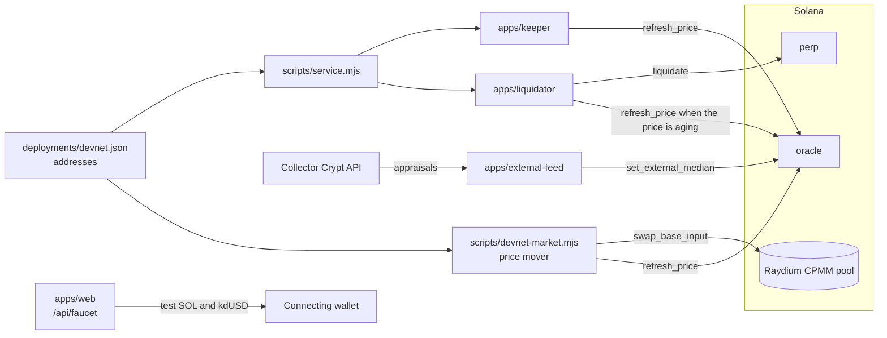
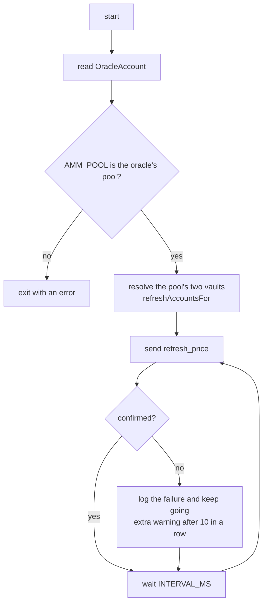
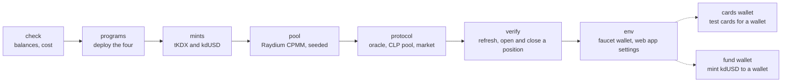

# Services and scripts

> [Docs](README.md) › Services · Up: [System map](system-map.md) · Related: [Devnet](devnet.md), [Deploying](deploying.md), [Flows](flows.md), [Collector Crypt](collector-crypt.md)

The off-chain processes that keep the market running, and the scripts that build, deploy and operate it. None of them holds a privileged price key: every instruction they send is either permissionless or gated by an on-chain admin check.



| Process | Source | Sends | Signer needs | Hosted on devnet |
|---|---|---|---|---|
| [Keeper](#keeper) | `apps/keeper/src/index.ts` | `oracle::refresh_price` | SOL for fees | yes |
| [Liquidator](#liquidator) | `apps/liquidator/src/index.ts` | `perp::liquidate` | SOL for fees | yes |
| [Price mover](#price-mover) | `scripts/devnet-market.mjs` | Raydium `swap_base_input`, then `refresh_price` | `tKDX`, `kdUSD` and SOL | yes |
| [External feed](#external-feed) | `apps/external-feed/src/index.ts` | `oracle::set_external_median` | The oracle admin key | run on demand |
| Faucet | `apps/web/app/api/faucet/route.ts` | SOL transfer and `kdUSD` transfer | The faucet key | yes, inside the web app |

## Keeper

Calls `refresh_price` on a loop so the oracle stays fresh. It computes no price and signs no price: the program reads the AMM itself. If the keeper stops, anyone can send the same instruction.



- Default interval: 5 seconds. The hosted devnet keeper runs at 10 seconds.
- The oracle's move cap is expressed in elapsed time, so refreshing more often does not move the price faster.
- Two keepers on different machines with different payers are safe: a second refresh in the same slot is a successful no-op.

Run it against the recorded deployment:

```sh
npm run typecheck      # builds the packages the service imports
npm run keeper         # node scripts/service.mjs keeper
```

Run it by hand: `KEEPER_KEYPAIR=<path> RPC_URL=<url> ORACLE=<oracle> AMM_POOL=<pool> npx tsx apps/keeper/src/index.ts`.

## Liquidator

Scans every open position of a market and liquidates the ones below the maintenance margin. The reward is 1% of notional. Sequence: [flows.md](flows.md#liquidation).

- Each pass reads `Market`, `Pool`, `OracleAccount` and every `Position` of the market (`getProgramAccounts`, filtered by discriminator and market).
- It decides with the SDK maths, the same arithmetic as the program. It uses the market's stored borrow index, which is never above the one the program accrues to, so it never sends a liquidation the program refuses for that reason.
- When the price is older than half the staleness limit it prepends `refresh_price` to the liquidation.
- A lost race with another liquidator is logged and ignored.
- `DRY_RUN=1` evaluates and logs without sending.

```sh
npm run liquidator     # node scripts/service.mjs liquidator
```

Run it by hand: `LIQUIDATOR_KEYPAIR=<path> RPC_URL=<url> MARKET=<market> npx tsx apps/liquidator/src/index.ts`.

## Price mover

`scripts/devnet-market.mjs` trades in the devnet Raydium pool so the index moves. Every swap is followed, in the same transaction, by `refresh_price`. It never trades on mainnet: it checks the genesis hash.

| Command | Effect |
|---|---|
| `status` | Prints the pool's spot price and reserves, the oracle price and state, and the trader's balances. |
| `to 1.03` | Trades until the pool's spot price is 1.03. |
| `nudge -2` | Moves the spot price by -2% from where it is. |
| `swing 0.03 600 15` | Oscillates 3% around the current price, one cycle every 600 seconds, one trade every 15 seconds. |
| `swing 0.03 600 15 1` | The same around 1.00, so a restart does not move the centre. |

Each trade moves the spot price by at most `KADEX_MARKET_MAX_STEP` (default 0.02). The hosted instance runs `swing 0.06 3600 30 1`.

```sh
npm run devnet:market -- status
```

The oracle keeps its 30-minute TWAP and its move cap on devnet, so the official price follows a swing slowly.

## External feed

Publishes the oracle's external reference, the value `set_external_median` stores. It is a sanity bound and never a price source: when a recent reference exists and the AMM price is more than `max_divergence` away from it, the oracle state becomes `Diverged` and new positions pause. Closing and liquidation continue.

- What it publishes: for each enabled whitelisted Core card, its current Collector Crypt appraisal over the appraisal it was whitelisted at, then the median weighted by `weight_bps`.
- It signs with the oracle admin key, the only key the instruction accepts, and checks that at start.
- It sends only when `PUBLISH=1`. Otherwise it logs what it would send.
- It refuses to send a zero, a value from fewer than `MIN_SAMPLES` cards, or a value outside `MIN_INDEX`..`MAX_INDEX`.

Run it: `PUBLISH=1 FEED_KEYPAIR=<path> ORACLE=<oracle> RPC_URL=<url> npx tsx apps/external-feed/src/index.ts`. Design and measurements: [collector-crypt.md](collector-crypt.md).

## Scripts

| Script | Command | What it does |
|---|---|---|
| `scripts/build.mjs` | `npm run build:programs` | Builds the programs for the SBPF v1 target and verifies every output is deployable. Reason: [deploying.md](deploying.md). |
| `scripts/bin/cargo-build-sbf` | used by the build | Shim that rewrites Anchor's `--arch v3` to `--arch v1`. |
| `scripts/devnet.mjs` | `npm run devnet -- <step>` | The devnet deployment, one re-runnable step at a time. Records addresses and signatures in `deployments/devnet.json`. |
| `scripts/service.mjs` | `npm run keeper`, `npm run liquidator` | Starts a service with the addresses from the deployment record. |
| `scripts/devnet-market.mjs` | `npm run devnet:market -- <command>` | The price mover. |
| `scripts/test-cards.mjs` | through `devnet.mjs cards <wallet>` | Creates devnet copies of Collector Crypt cards as Metaplex Core assets and whitelists each at the original's appraisal. |
| `scripts/select-basket.mjs` | `node scripts/select-basket.mjs` | Selects the launch basket by written rules from live Collector Crypt listings and writes `deployments/basket.json`. |
| `scripts/whitelist-core.mjs` | `node scripts/whitelist-core.mjs <asset> --weight-bps <n>` | Whitelists one Core card at its appraisal, or a whole basket with `--basket <file>`. |
| `scripts/size-market.mjs` | `node scripts/size-market.mjs [depth] [sleeve]` | Prints both open-interest ceilings and the cost of an attack for a given AMM depth and pool sleeve. |
| `scripts/ab-test.mjs` | `npm run ab` | Compares risk parameter sets by modelling a quarter of trader behaviour with the SDK maths. |
| `scripts/with-validator.mjs` | used by `test:integration`, `test:cc:chain`, `dev:chain` | Boots a throwaway local validator with the programs deployed, runs a command, tears it down. |
| `scripts/dev-chain.mjs` | `npm run dev:chain -- <wallet>` | A local validator with a seeded pool. Funds the wallet, writes `apps/web/.env.local` and keeps the price fresh. |

Steps of `scripts/devnet.mjs`:



`all` runs the solid chain in order. Each step checks the chain and skips what already exists.

## Environment variables

Names and purpose only.

| Variable | Used by | Purpose |
|---|---|---|
| `RPC_URL` | keeper, liquidator, external feed, `whitelist-core.mjs` | RPC endpoint. |
| `INTERVAL_MS` | keeper, liquidator, external feed | Loop interval. Defaults: 5,000, 5,000 and 60,000. |
| `KEEPER_KEYPAIR` | keeper | Fee payer: a keypair file path or the JSON array itself. |
| `ORACLE` | keeper, external feed | The `OracleAccount` address. |
| `AMM_POOL` | keeper | The AMM pool the oracle reads. Checked against the oracle at start. |
| `LIQUIDATOR_KEYPAIR` | liquidator | Fee payer, and the wallet that receives rewards. |
| `MARKET` | liquidator | The `Market` address to watch. |
| `IDL_DIR` | liquidator, `whitelist-core.mjs` | Folder with the Anchor IDLs. `service.mjs` falls back to `deployments/idl`. |
| `DRY_RUN` | liquidator, `select-basket.mjs`, `whitelist-core.mjs` | `1` evaluates and prints without sending. |
| `FEED_KEYPAIR` | external feed | Must be the oracle admin. |
| `PUBLISH`, `SOURCE`, `MIN_SAMPLES`, `MIN_INDEX`, `MAX_INDEX` | external feed | Whether to send, what to send, and the bounds a value must pass. |
| `KADEX_DEPLOYMENT` | `service.mjs`, `devnet.mjs`, `devnet-market.mjs`, `dev-chain.mjs` | Path of the deployment record. Default `deployments/devnet.json`, or `deployments/local.json` for `dev-chain.mjs`. |
| `DEVNET_RPC` | `service.mjs`, `devnet.mjs`, `devnet-market.mjs` | RPC endpoint. Default the public devnet endpoint. |
| `KADEX_DEPLOYER` | `devnet.mjs` | The deployer keypair path. It becomes the upgrade authority. |
| `KADEX_SERVICE_KEYPAIR` | `service.mjs` | Payer for the keeper and the liquidator. |
| `KADEX_MARKET_KEYPAIR` | `devnet-market.mjs` | The price mover's wallet. |
| `KADEX_MARKET_MAX_STEP` | `devnet-market.mjs` | Largest price move per trade. |
| `KADEX_CARDS` | `devnet.mjs cards` | Comma-separated Collector Crypt addresses to copy. |
| `KADEX_ENV_FILE`, `KADEX_BROWSER_RPC`, `KADEX_NETWORK` | `devnet.mjs env`, `dev-chain.mjs` | Where the web app settings are written, and with which RPC and network. |
| `ADMIN_KEYPAIR` | `whitelist-core.mjs` | The registry admin. |
| `COLLECTOR_CRYPT_API_KEY` | external feed, scripts | Optional. Raises the Collector Crypt rate limit. |

Keypairs are loaded by `loadKeypair` in `@kadex/sdk/node`, which never prints file contents in an error. Web app variables: [web-app.md](web-app.md#environment-variables).

## Hosting

The hosted devnet processes run as services of one Railway project. Each is deployed by uploading the checkout. Source: [deploying.md](deploying.md).

| Service | Start command | What it is |
|---|---|---|
| `web-devnet` | `npm run start -w @kadex/web` | The web app wired to devnet, including the faucet route. |
| `keeper` | `node scripts/service.mjs keeper` | The keeper, at a 10 second interval. |
| `liquidator` | `node scripts/service.mjs liquidator` | The liquidator. |
| `market` | `node scripts/devnet-market.mjs swing 0.06 3600 30 1` | The price mover: 6% around 1.00, one cycle an hour. |

The keeper, the liquidator and the price mover read `deployments/devnet.json` and `deployments/idl/` from the upload. Each has its own wallet with a little devnet SOL. None of them is the deployer.

## Where to go next

- [devnet.md](devnet.md): the addresses these services point at.
- [deploying.md](deploying.md): the build, the deployment script and the hosting details.
- [flows.md](flows.md): the liquidation and price refresh sequences.
- [collector-crypt.md](collector-crypt.md): the data behind the external feed and the test cards.
- [Docs index](README.md)
