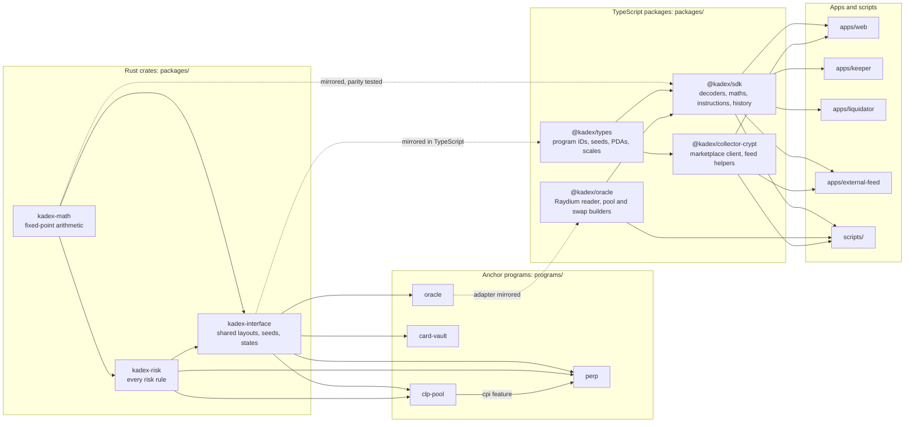
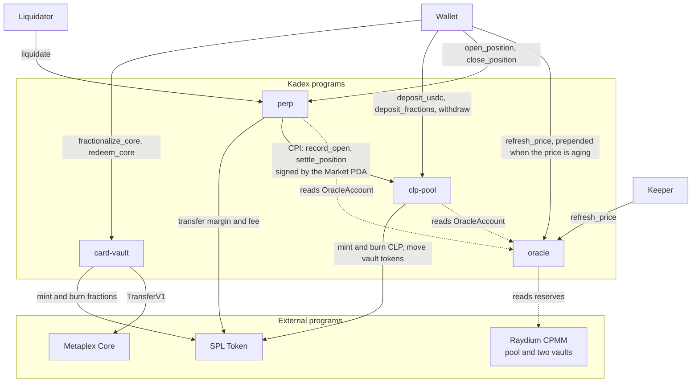
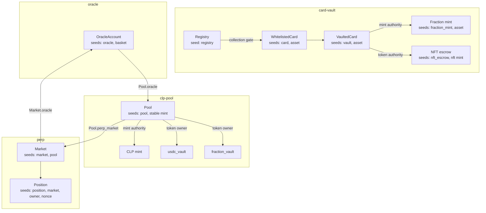
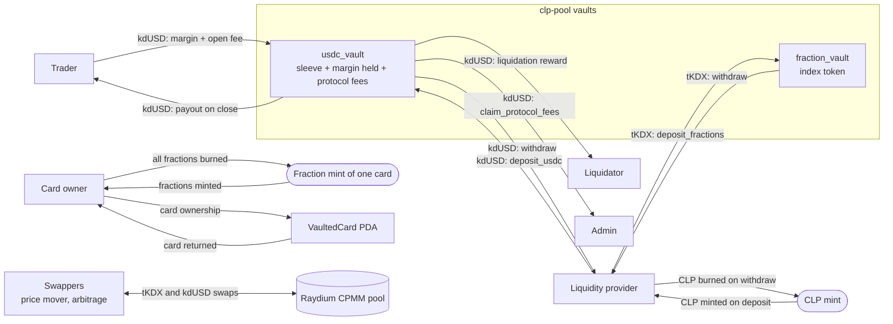

# System map

> [Docs](README.md) › System map · Up: [Overview](overview.md) · Related: [Architecture](architecture.md), [Programs](programs.md), [Flows](flows.md), [Web app](web-app.md), [Services](services.md)

Four graphs describe the system: what depends on what in the code, what calls what on chain, which accounts exist, and where each token moves. The tables at the end say what every node is.

## Code dependencies

One Cargo workspace for Rust and one npm workspace for TypeScript, in the same repository. An arrow means "is imported by".

The graph keeps the main path. Two shortcuts are left out: every program also imports `kadex-math` directly, and the apps import `@kadex/types` directly as well as through `@kadex/sdk`, which re-exports it.

Rules the build enforces:

- `kadex-risk` depends on `kadex-math` only. The test `risk_crate_cannot_reach_solana` in `programs/perp` fails if it gains an Anchor or Solana dependency.
- A handler in `programs/perp` longer than 45 lines fails `handlers_stay_thin`. Decisions belong in `kadex-risk`.
- The TypeScript seeds, scales and maths are held to the Rust by `tests/parity.test.mjs`.

## On-chain runtime

What calls what in a live transaction. Solid arrows are instructions or CPIs. Dotted arrows are account reads.

Three facts make this graph safe to reason about:

- **The oracle is read, never called.** `perp` and `clp-pool` deserialize `OracleAccount` through `read_oracle`, which checks that the oracle program owns the account. There is no CPI into `oracle`.
- **One door out of the pool.** `settle_position` is the only instruction that pays a trader or a liquidator, and it requires the signature of the single Market PDA stored in `Pool.perp_market`.
- **`card-vault` is independent.** It knows nothing about prices, pools or positions.

## Accounts and PDAs

| Account | Owner program | Seeds | Size in bytes | Created by |
|---|---|---|---|---|
| `Registry` | `card-vault` | `"registry"` | 77 | `initialize_registry` |
| `WhitelistedCard` | `card-vault` | `"card"`, asset address | 85 | `whitelist_core_card`, `whitelist_card` |
| `VaultedCard` | `card-vault` | `"vault"`, asset address | 114 | `whitelist_core_card`, `whitelist_card` |
| Fraction mint | SPL Token | `"fraction_mint"`, asset address | 82 | `whitelist_core_card`, `whitelist_card` |
| NFT escrow | SPL Token | `"nft_escrow"`, NFT mint | 165 | `fractionalize` (SPL NFT path) |
| `OracleAccount` | `oracle` | `"oracle"`, basket mint | 1265 | `initialize` |
| `Pool` | `clp-pool` | `"pool"`, stable mint | 554 | `initialize_pool` |
| `Market` | `perp` | `"market"`, pool address | 197 | `initialize_market` |
| `Position` | `perp` | `"position"`, market, owner, nonce as 8 little-endian bytes | 130 | `open_position` |

Notes for readers of the code:

- The CLP mint, `usdc_vault` and `fraction_vault` are not PDAs. They are ordinary SPL accounts created before `initialize_pool`, which checks that the Pool PDA is the CLP mint authority and the owner of both vaults, and then stores their addresses on the `Pool`. Nothing can rebind them later.
- `kadex-interface` also declares the seeds `clp_mint`, `usdc_vault` and `card_sleeve`. No instruction derives an address from them.
- On the Metaplex Core path the card is not held in a token account. The `VaultedCard` PDA becomes the asset's owner.
- The seeds live in `kadex_interface::seeds` and are mirrored in `@kadex/types` (`findPool`, `findMarket`, `findOracle`, `findPosition`, `findRegistry`, `findCard`, `findVaultedCard`, `findFractionMint`, `findNftEscrow`).

## Token flow

Accounting identities the programs keep:

- `usdc_vault` balance = `usdc_sleeve` + `margin_held` + `accrued_fees_protocol`. Only `usdc_sleeve` belongs to liquidity providers.
- Every open and close fee is split when it is booked. With the devnet parameters 75% joins `usdc_sleeve` and 25% is held for the protocol until `claim_protocol_fees`.
- Fraction supply of a card is `fractions_per_card` while the card is locked and `0` after redemption.
- The card sleeve is stored as a token quantity (`fraction_balance`). Its value is computed at read time from the oracle price.

## Node reference

### Rust crates

| Path | Role | Depends on |
|---|---|---|
| [`packages/kadex-math`](../packages/kadex-math/src/lib.rs) | Integer fixed-point arithmetic: scales, rounding, borrow index, PnL, liquidation price, the two ceilings, NAV, share maths | nothing |
| [`packages/kadex-risk`](../packages/kadex-risk/src/lib.rs) | Decisions as pure functions: `capacity`, `check_open`, `check_withdraw`, `accrue`, `is_liquidatable`, `settle_close`, `settle_liquidation` | `kadex-math` |
| [`packages/kadex-interface`](../packages/kadex-interface/src/lib.rs) | Shared serializable shapes: PDA seeds, `OracleAccount`, `OracleView`, `PoolParams`, `MarketState`, `OracleState`, `BookSnapshot`, `require_deployer` | `anchor-lang`, `kadex-math`, `kadex-risk` |

### Programs

| Path | Program ID | Role |
|---|---|---|
| [`programs/oracle`](../programs/oracle/src/lib.rs) | `5288ShBXsFxqXiGm22FZi1ZrMnmet4i1ZR3bccyAguqp` | Reads AMM reserves and publishes the official price |
| [`programs/clp-pool`](../programs/clp-pool/src/lib.rs) | `3XZkAqLeQDoNXD6Bb9YoGSEdnvqk9r7UMgrKsN5x3L9v` | Liquidity pool, NAV, CLP mint and burn, settlement |
| [`programs/perp`](../programs/perp/src/lib.rs) | `BcVwJ91Jd1k7xUNcGYzRygq2ubaCYn7p5MeUZzy1EyLR` | Positions, borrow, liquidation |
| [`programs/card-vault`](../programs/card-vault/src/lib.rs) | `J8Tef8N4YSfVwAxpBemCZrz3qCxehTeb2cd1jTwoBczW` | Card custody and fractions |

Instructions, accounts, events and errors: [programs.md](programs.md).

### TypeScript packages

| Package | Path | Role | Main exports |
|---|---|---|---|
| `@kadex/types` | [`packages/types`](../packages/types/src/index.ts) | Mirror of `kadex-interface` | `PROGRAM_IDS`, `SEEDS`, `find*`, `WAD`, `BPS`, `RAY`, `gates`, `oracleTradeable`, view types |
| `@kadex/oracle` | [`packages/oracle`](../packages/oracle/src) | Mirror of the on-chain reserve adapter | `readRaydium`, `decodePool`, `refreshAccounts`, `spotPrice`, `createPoolIx`, `swapBaseInputIx` |
| `@kadex/sdk` | [`packages/sdk`](../packages/sdk/src) | The single door from TypeScript into the protocol | `math`, `decodePool`, `decodeOracle`, `decodeMarket`, `decodePosition`, `derivePosition`, `deriveCapacity`, `deriveBorrowRates`, `derivePool`, `navIssue`, instruction builders, `readPriceHistory`, `readLpEvents`, `readCoreCard`, `readVaultInventory` |
| `@kadex/sdk/node` | [`packages/sdk/src/node.ts`](../packages/sdk/src/node.ts) | Node-only helpers for services and scripts | `loadKeypair`, `intFromEnv`, `redactUrl` |
| `@kadex/collector-crypt` | [`packages/collector-crypt`](../packages/collector-crypt/src) | Collector Crypt marketplace and gacha client, rate limits | `fetchMarketplacePage`, `fetchCard`, `isVaultable`, `categoryGroup`, `fetchGachaMachines`, `collectorCryptLimits` |
| `@kadex/collector-crypt/chain` | [`packages/collector-crypt/src/chain.ts`](../packages/collector-crypt/src/chain.ts) | On-chain helpers for the external reference | `whitelistedCoreCards`, `readAppraisalIndex`, `publishDecision`, `setExternalMedianIx` |

### Apps and scripts

| Path | Role | Document |
|---|---|---|
| [`apps/web`](../apps/web) | Next.js app: Trade, Earn, Vault, Portfolio, index methodology, API routes | [web-app.md](web-app.md) |
| [`apps/keeper`](../apps/keeper/src/index.ts) | Calls `refresh_price` on a loop | [services.md](services.md#keeper) |
| [`apps/liquidator`](../apps/liquidator/src/index.ts) | Scans positions and sends `liquidate` | [services.md](services.md#liquidator) |
| [`apps/external-feed`](../apps/external-feed/src/index.ts) | Publishes the external reference with `set_external_median` | [services.md](services.md#external-feed) |
| [`scripts`](../scripts) | Build, deployment, price mover, basket selection, whitelisting, local chain | [services.md](services.md#scripts) |
| [`tests`](../tests) | Parity, history, Raydium reader, Collector Crypt and validator suites | [testing.md](testing.md) |
| [`deployments`](../deployments) | Devnet record, launch basket, IDLs | [devnet.md](devnet.md) |

## Where to go next

- [programs.md](programs.md): the instruction and account reference for each program.
- [flows.md](flows.md): the same graph in motion, one flow at a time.
- [architecture.md](architecture.md): why the boundaries are where they are.
- [web-app.md](web-app.md) and [services.md](services.md): the off-chain half.
- [Docs index](README.md)
