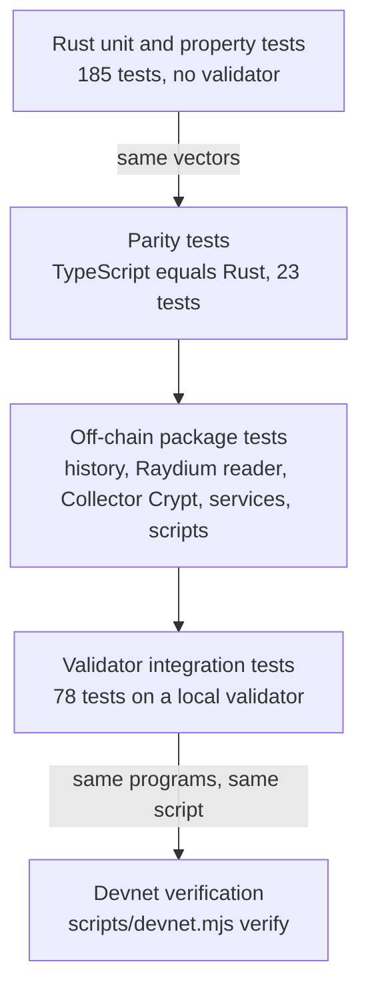

# Testing

> [Docs](README.md) › Testing · Up: [Docs index](README.md) · Related: [Invariants](invariants.md), [Programs](programs.md), [Deploying](deploying.md), [System map](system-map.md)

The rules are tested where they are cheapest to test. Risk decisions are pure Rust functions, so they run in milliseconds without a validator. Account validation, signer constraints and CPI authority are tested against real program binaries on a local validator.

## Suites

Counts are the number of `#[test]` attributes and `test(...)` calls in the source, counted on 12 Oct 2026.

| Suite | Command | Source | Tests | What it proves |
|---|---|---|---|---|
| Rust unit and property | `npm run test:rust` | `programs/*/src`, `packages/kadex-*/src` | 185 | The economic invariants, the oracle defences, the share and rounding maths, and the structural guards. |
| Parity | `npm run test:parity` | `tests/parity.test.mjs` | 23 | The TypeScript maths, seeds and state gates give the same answers as the Rust. |
| History and activity | `npm run test:history` | `tests/history.test.mjs`, `tests/activity.test.mjs` | 18 | Event decoding, the price series, the liquidity provider return and the utilisation series. |
| Raydium reader | `npm run test:raydium` | `tests/raydium.test.mjs` | 23 | The TypeScript Raydium adapter on a pool captured from devnet, with the same expected numbers as the Rust adapter. |
| Collector Crypt | `npm run test:cc` | `tests/collector-crypt.test.mjs`, `tests/collector-crypt-gacha.test.mjs`, `tests/basket.test.mjs` | 53 | The API client, the rate limits, the gacha client and the basket selection rules. |
| Services configuration | `npm run test:services` | `tests/node-config.test.mjs` | 8 | Keypair loading and environment parsing in `@kadex/sdk/node`. |
| Price mover | `npm run test:market` | `tests/devnet-market.test.mjs` | 9 | Swap planning of `scripts/devnet-market.mjs`: targets, the step limit, the wave. |
| Scripts | `npm run test:scripts` | `tests/scripts.test.mjs` | 5 | Test card weights, and that `scripts/service.mjs` reads the deployment record. |
| Validator integration | `npm run test:integration` | `tests/integration/*.test.mjs` | 78 | The deployed binaries: lifecycle, oracle defences, deposits, vault, SDK. |
| Collector Crypt on a validator | `npm run test:cc:chain` | `tests/cc/whitelist.test.mjs` | 12 | Whitelisting a Collector Crypt card at its appraisal, and the external reference: who may publish it and when it trips the divergence bound. |
| Collector Crypt live | `npm run test:cc:live` | `tests/cc/gacha.live.mjs` | 4 | The gacha client against the live API. Needs the gacha API key. |

Every JavaScript suite first compiles the TypeScript packages it needs with `tsc -b`. `npm run typecheck` compiles all four.

## Rust tests in the shared crates and the deployed programs

| Crate | Tests | Focus |
|---|---|---|
| `kadex-math` | 43 | Fixed-point arithmetic, rounding direction, and property tests of 20,000 cases each on a fixed seed. |
| `kadex-risk` | 36 | The two ceilings, `check_open`, `check_withdraw`, borrow, liquidation and settlement. |
| `kadex-interface` | 15 | State gates, parameter defaults, the oracle view, the upgrade authority reader. |
| `oracle` | 43 | Each defence against repeated refreshes, pushed prices and borrowed depth, plus the Raydium adapter checks. |
| `clp-pool` | 30 | NAV, deposit and withdrawal round trips, state gates, the settlement haircut. |
| `card-vault` | 7 | Fraction decimals and the Metaplex Core asset reader on bytes captured from mainnet. |
| `perp` | 3 | `handlers_stay_thin`, `risk_crate_cannot_reach_solana`, and the program ID pinned in the interface. |

These seven crates hold 177 of the 185 tests in the Cargo workspace.

## Validator integration tests

`scripts/with-validator.mjs` boots a throwaway `solana-test-validator`, deploys the programs at their fixed addresses, runs the command and tears the validator down. The Metaplex Core program and Raydium's CPMM program are loaded from binaries in `tests/fixtures`, so the vault and the Raydium adapter are tested against the real programs.

| File | Tests | Covers |
|---|---|---|
| `lifecycle.test.mjs` | 18 | Deposit, open, NAV, the zero-sum check, both ceilings, withdrawal gates, `ReduceOnly`, settlement, stale price, borrow accrual, who may initialize. |
| `oracle.test.mjs` | 12 | The oracle defences on a live runtime. |
| `raydium.test.mjs` | 11 | The oracle on a Raydium CPMM pool, and the perp market consuming it. |
| `sdk.test.mjs` | 10 | `@kadex/sdk` decoders, quotes and instructions against the deployed programs. |
| `vault.test.mjs` | 10 | The card vault, SPL and Metaplex Core paths. |
| `deposits.test.mjs` | 9 | `deposit_fractions`: haircut, sleeve target, marks. |
| `vault-sdk.test.mjs` | 5 | Each `vaultAction` state through the SDK. |
| `activity.test.mjs` | 3 | Liquidity provider history and utilisation from events. |

Requirements: the Solana CLI on the PATH and the programs built with `npm run build:programs`. The run is a separate command because it takes far longer than `cargo test`.

## What the negative tests cover

The refusals matter more than the happy path. Each of these has a test: capacity exceeded, a forged oracle account, a jump past the move cap, a stale price, insufficient depth, divergence from the external reference, opening outside `Active`, insufficient margin, liquidation before the threshold, bad debt, and the pro-rata haircut at settlement. The list of invariants with the test that guards each one is in [invariants.md](invariants.md).

## Devnet verification

`node scripts/devnet.mjs verify` runs against the deployed programs: it refreshes the price, checks that the program and the TypeScript reader compute the same spot from the Raydium pool, requires oracle state `Ok`, then deposits into the pool and opens and closes a position. The signatures of that run are recorded in [`deployments/devnet.json`](../deployments/devnet.json) and listed in [devnet.md](devnet.md#transactions).

## Where to go next

- [invariants.md](invariants.md): the rule behind each test.
- [programs.md](programs.md): the instructions under test.
- [deploying.md](deploying.md): building the binaries the validator suite deploys.
- [Docs index](README.md)
