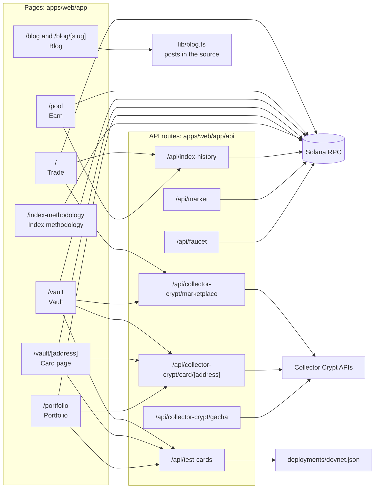
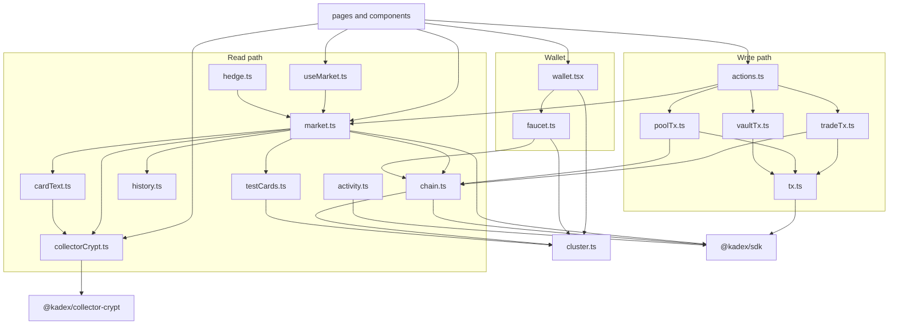

# Web app

> [Docs](README.md) › Web app · Up: [System map](system-map.md) · Related: [Frontend contract](frontend-contract.md), [Collector Crypt](collector-crypt.md), [Flows](flows.md), [Devnet](devnet.md)

`apps/web` is a Next.js 15 app (App Router, React 19) with hand-written CSS. It reads accounts over RPC from the browser, builds transactions with `@kadex/sdk`, and asks the connected wallet to sign. Server-side API routes cover what the browser should not do itself: the faucet, the price history and the Collector Crypt calls.

Hosted build wired to devnet: https://web-devnet-production.up.railway.app

## Routes

| Route | File | What it shows |
|---|---|---|
| `/` | `app/page.tsx` | Trade. The index chart, market statistics, the trade ticket with Trade and Hedge modes, the wallet's account panel with open positions, a rail of vaultable cards, a four-step explainer, the latest blog posts and a FAQ. |
| `/pool` | `app/pool/page.tsx` | Earn. Pool value, CLP price, the deposit and withdraw ticket, and "Your position": shares held, what a full withdrawal returns, return since the first deposit, utilisation through time. |
| `/vault` | `app/vault/page.tsx` | Vault. Collector Crypt listings that can be vaulted, with search by name or address, category groups, sort order, marketplace source and price range. Also "Your vaulted cards" and, on devnet, the test cards. |
| `/vault/[address]` | `app/vault/[address]/page.tsx` | One card: the slab in 3D, grade, certification number, appraisal, the fractions it mints, asking price, population, and the vault or redeem action. |
| `/portfolio` | `app/portfolio/page.tsx` | The wallet's open PnL beside the pool's NAV, open positions, vaulted cards and pool shares. |
| `/index-methodology` | `app/index-methodology/page.tsx` | The basket composition and weights, both capacity ceilings and which one binds, and the methodology text. |
| `/blog` | `app/blog/page.tsx` | The list of posts: market news and guides. |
| `/blog/[slug]` | `app/blog/[slug]/page.tsx` | One post, statically generated from `lib/blog.ts`. |
| `/market` | `app/market/page.tsx` | Redirects to `/`. |

`app/layout.tsx` wraps every page in `WalletProvider` and `Frame` (header, navigation, footer). `app/sitemap.ts`, `app/robots.ts` and `app/manifest.ts` generate the crawler files. `robots.ts` disallows `/api/`.

## API routes

| Route | Method | Returns | Notes |
|---|---|---|---|
| `/api/index-history` | GET | `{ step, points: [{ ts, price }] }`: 24 hours of 5-minute prices, WAD as strings | Built from the oracle's `PriceRefreshed` events, cached for 30 seconds. See [flows.md](flows.md#index-chart-history). |
| `/api/market` | GET | Oracle price, long and short borrow per month, the spread, the crowded side, the side that is paid, remaining capacity, pool NAV, timestamps | Machine-readable market state for bots and arbitrageurs. |
| `/api/faucet` | POST `{ wallet }` | `{ funded, signature }` | Sends test SOL and the stable token to a wallet that has none. Refuses on mainnet. Rate limited. See [flows.md](flows.md#faucet). |
| `/api/test-cards` | GET | `{ cards, recorded }` | The devnet test cards recorded in `deployments/<network>.json`. |
| `/api/collector-crypt/marketplace` | GET | A page of listings, filtered to vaultable Metaplex Core cards, with category counts | Query: `search`, `owner`, `group`, `sort`, `source`, `min`, `max`, `cursor`. |
| `/api/collector-crypt/card/[address]` | GET | One card's catalogue data | 404 when Collector Crypt has no card at that address. |
| `/api/collector-crypt/gacha` | GET | Collector Crypt gacha machines and stock | Uses the gacha API key when one is set. |

The Collector Crypt routes run on the server so the API keys never reach the browser. Field mapping and rate limits: [collector-crypt.md](collector-crypt.md).

## lib modules

An arrow means "imports".

| Module | Role |
|---|---|
| `cluster.ts` | Reads the cluster configuration from the environment. Exports `CLUSTER` (RPC URL, stable mint, connection, network), `TEST_FUNDS` and `USD_LABEL` (`kdUSD` on devnet and local, `USDC` otherwise). |
| `chain.ts` | Reads `Pool`, `OracleAccount` and `Market` in one call, token balances and a wallet's positions. Identical reads are shared for 3 seconds to stay inside public RPC limits. |
| `market.ts` | The screen's view of the market: `loadMarket`, `loadPositions`, `loadPortfolio`, `loadIndexHistory`, and the quotes `quote`, `quoteDeposit`, `quoteWithdraw`, `borrowSpread`. Also `CONSTITUENTS`, the launch basket from `deployments/basket.json`. |
| `useMarket.ts` | React hook. One poll for the whole page, every 10 seconds, shared by every component that reads the market. |
| `hedge.ts` | `suggestHedge`: sizes a short from inventory value, two user limits and remaining capacity. |
| `history.ts` | Constants and the wire type of the price history: 288 points, 300 seconds each. |
| `activity.ts` | A wallet's pool events and the market's utilisation series, read from transaction logs and cached per signature. |
| `actions.ts` | One function per user action: `openPosition`, `closePosition`, `poolAction`, `vaultCard`, `redeemCard`. |
| `tradeTx.ts` | Builds and sends `open_position` and `close_position`. |
| `poolTx.ts` | Builds and sends `deposit_usdc`, `deposit_fractions` and `withdraw`, creating token accounts when missing. |
| `vaultTx.ts` | Reads a card's on-chain state and sends `fractionalize_core` or `redeem_core`. |
| `tx.ts` | `refreshIfAging` (prepends `refresh_price` when the price is past half its staleness limit), `sendInstructions` (blockhash, signature, send, confirm) and `explainTxError`. |
| `wallet.tsx` | `WalletProvider` and `useWallet`. Discovers wallets through the Wallet Standard, supports an injected Phantom provider, and off mainnet offers a built-in demo wallet whose key is generated and kept in the browser. Requests test funds on connect. |
| `faucet.ts` | Client call to `/api/faucet`. |
| `collectorCrypt.ts` | Client calls to the Collector Crypt API routes and the wire types. |
| `cardText.ts` | Formats card titles, grades and the ask-to-appraisal ratio. |
| `testCards.ts` | Client call to `/api/test-cards` and the lookup between a devnet card and its mainnet original. |
| `amount.ts` | Parses and formats 6-decimal amounts as `BigInt`. |
| `blog.ts` | The blog posts as typed data (`POSTS`), with `postBySlug` and `fmtPostDate`. |
| `site.ts`, `brand.ts` | Site URL, tagline, description and per-page metadata. |

Note for readers of the code: when no RPC URL is configured, `apps/web` runs against a local simulation (`lib/sim.ts`, `IS_SAMPLE` in `lib/market.ts`), which is used for UI development.

Rules the app follows, set out in [frontend-contract.md](frontend-contract.md):

- No account is deserialized by hand and no PDA is derived by hand. Everything goes through `@kadex/sdk`.
- Every amount is a `BigInt`. Conversion to `Number` happens on the last line, for display.
- A quote uses the same functions as the program, so the liquidation price on screen is the one the chain records.

## Components

| Component | Role |
|---|---|
| `Frame` | App shell: header, navigation (Trade, Earn, Vault, Portfolio), wallet button, footer. |
| `WelcomeDialog` | First-visit walkthrough, shown once per browser. |
| `HomeBanner` | Banners of the Trade and Vault pages. |
| `HowItWorks` | The four-step explainer. |
| `IndexChart` | Candle and line chart of the index history. |
| `LiveChart` | The live price line and the ticking price. |
| `TradeTicket` | Order form with Trade and Hedge modes. |
| `HedgeSuggestion` | Reads the wallet's card inventory and suggests a short. |
| `AccountPanel` | The wallet's positions, vaulted cards and pool shares on the Trade page. |
| `PositionsTable` | Open positions: side, size, margin, entry, mark, liquidation price, PnL, and a close button. |
| `PnlNavPanel` | The wallet's open PnL beside the pool's NAV. |
| `LpPosition` | A liquidity provider's position, return and the utilisation trend. |
| `CardRail`, `CardPreview` | A rail of vaultable cards and the card dialog it opens. |
| `CardStage`, `TiltSlab`, `Slab` | The graded slab drawn in CSS, in 3D, and thumbnails. |
| `VaultActions` | The vault and redeem buttons, driven by `vaultAction` from the SDK. |
| `VaultInventory` | "Your vaulted cards": held, still needed, value at appraisal. |
| `TestCards` | The devnet test cards row. |
| `BlogSection`, `BlogCard` | The blog strip on the Trade page and the card of one post. |
| `HomeFaq` | Questions and answers on the Trade page. |
| `UiSwitch` | Interface style switcher component. |
| `ArrowIcon` | Arrow icon used in links and buttons. |

## Environment variables

Names and purpose only. Values live in `apps/web/.env.local`, which is not committed. A template with comments is in [`apps/web/.env.example`](../apps/web/.env.example).

| Variable | Read by | Purpose |
|---|---|---|
| `NEXT_PUBLIC_KADEX_RPC_URL` | Browser and server | The RPC endpoint the app reads from and sends through. |
| `NEXT_PUBLIC_KADEX_USDC_MINT` | Browser and server | The pool's stable mint. The Pool address is derived from it. |
| `NEXT_PUBLIC_KADEX_NETWORK` | Browser and server | `local`, `devnet` or `mainnet`. Optional: inferred from the RPC URL. |
| `NEXT_PUBLIC_SITE_URL` | Server | Canonical site URL for metadata. Falls back to `RAILWAY_PUBLIC_DOMAIN`. |
| `RAILWAY_PUBLIC_DOMAIN` | Server | Set by the host. |
| `KADEX_FAUCET_KEYPAIR` | Server only | The faucet's signing key: a JSON array or a path to one. Never a key that holds real value. |
| `KADEX_FAUCET_SOL` | Server only | SOL per grant. Default 0.05. |
| `KADEX_FAUCET_USDC` | Server only | Stable token per grant. Default 1,000. |
| `KADEX_DEPLOYMENT` | Server only | Path of the deployment record `/api/test-cards` reads. Default `deployments/<network>.json`. |
| `COLLECTOR_CRYPT_API_KEY` | Server only | Optional. Raises the Collector Crypt marketplace rate limit. |
| `COLLECTOR_CRYPT_GACHA_API_KEY` | Server only | Optional. Collector Crypt gacha API key. |

The `NEXT_PUBLIC_*` values are read at build time. `scripts/devnet.mjs env` writes the three cluster lines and the faucet key into `apps/web/.env.local` and keeps every other line.

## Commands

| Command | What it runs |
|---|---|
| `npm run typecheck` | Compiles the four TypeScript packages into their `dist/` folders, which the app imports. |
| `npm run web` | `next dev` on port 3000. |
| `npm run web:build` | Compiles the packages, then `next build`. |

## Where to go next

- [frontend-contract.md](frontend-contract.md): the SDK calls behind each screen.
- [flows.md](flows.md): what each button sends.
- [collector-crypt.md](collector-crypt.md): where the card data comes from.
- [devnet.md](devnet.md): the addresses the hosted app points at.
- [Docs index](README.md)
